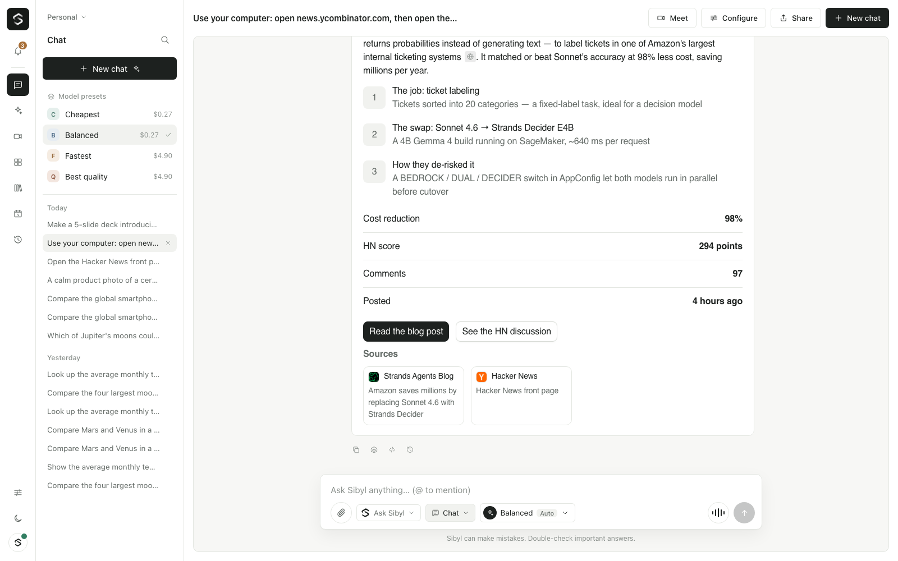
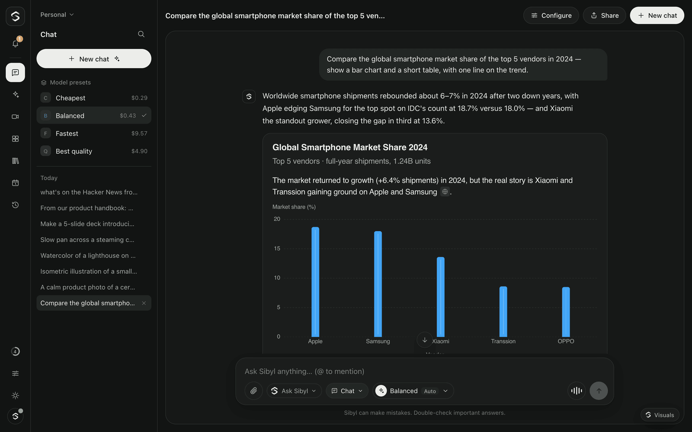
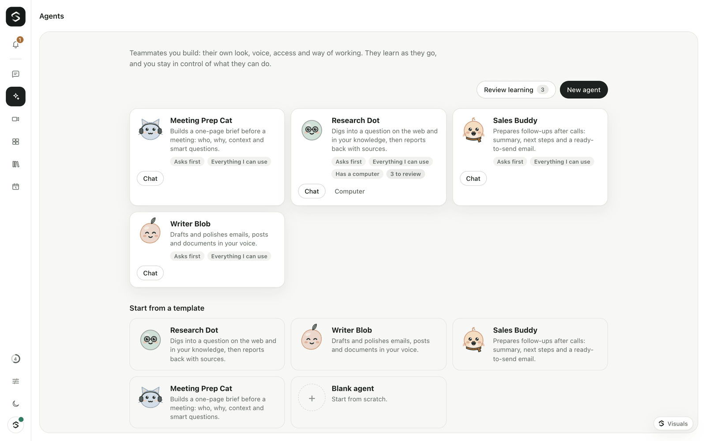
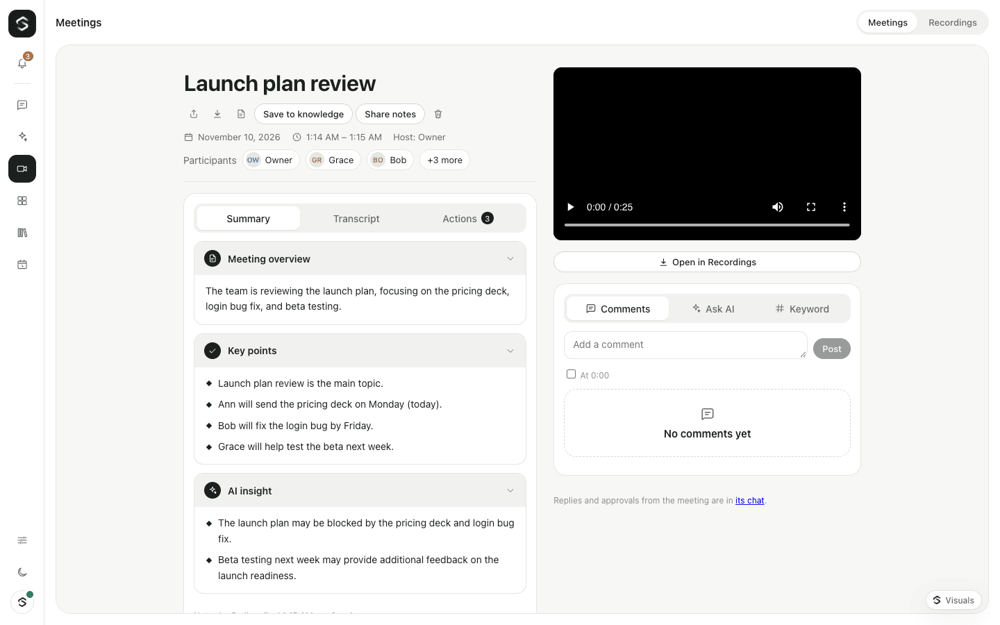
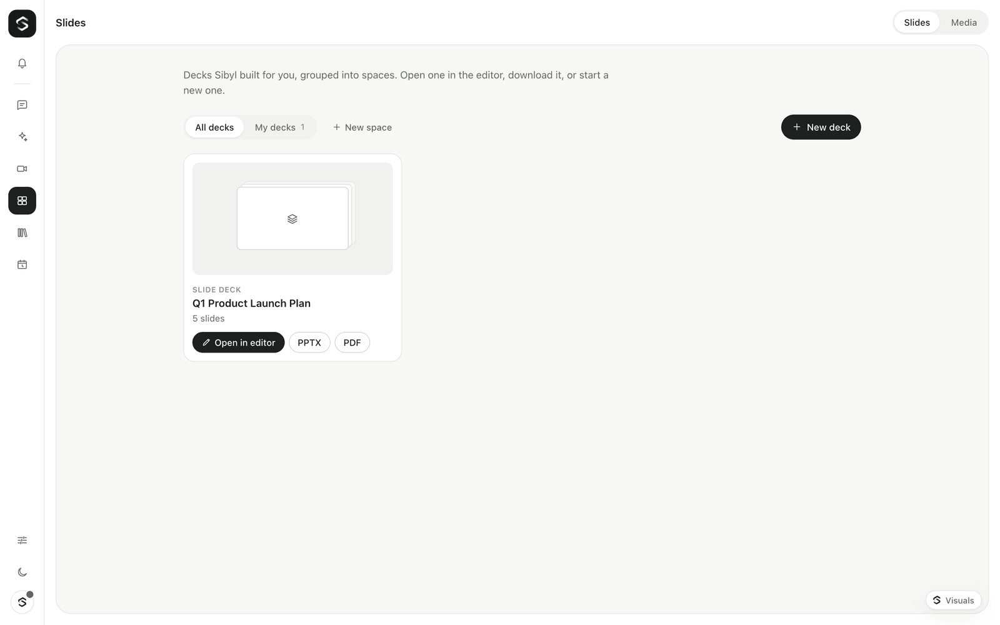
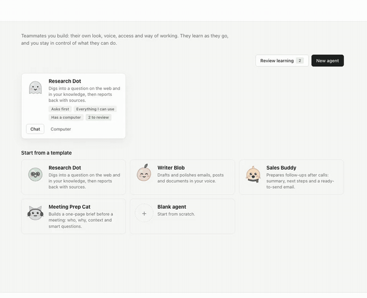
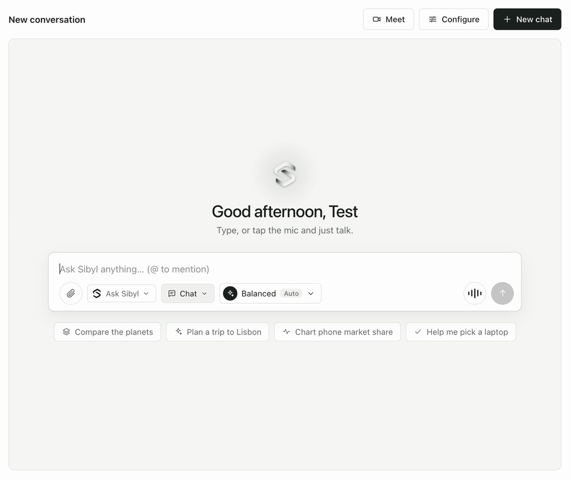
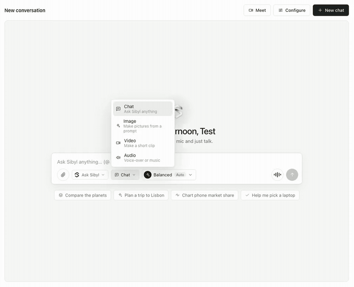
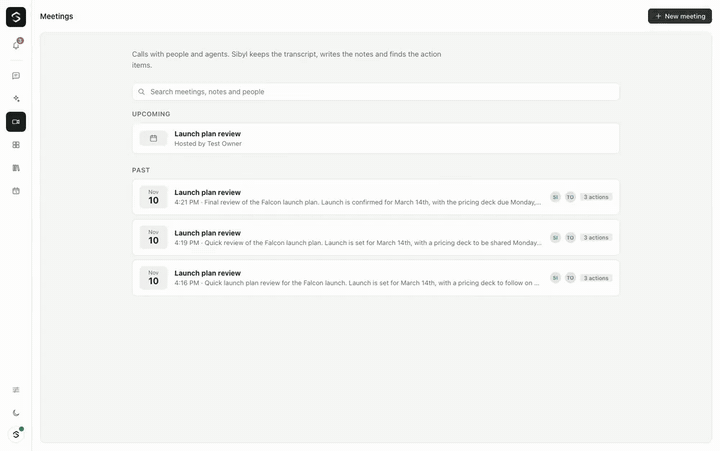
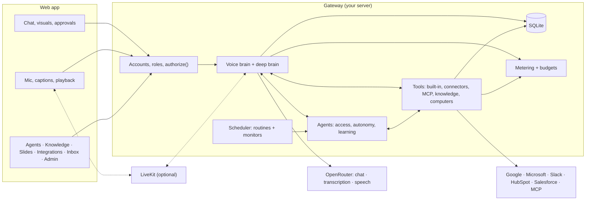

<p align="center">
  <picture>
    <source media="(prefers-color-scheme: dark)" srcset="docs/assets/sibyl-mark-dark.png" />
    
  </picture>
</p>

<h1 align="center">Sibyl</h1>

<p align="center">
  <strong>Open-source alternatives to the tools you pay for every month.</strong><br />
  Pay only for what matters: the AI you use.
</p>

<p align="center">
  <a href="https://opensibyl.world">Website</a> ·
  <a href="docs/getting-started.md">Get started</a> ·
  <a href="docs/agents.md">Agents</a> ·
  <a href="docs/voice.md">Voice</a> ·
  <a href="docs/integrations.md">Integrations</a> ·
  <a href="docs/models-and-costs.md">Models &amp; costs</a> ·
  <a href="docs/deployment.md">Deployment</a> ·
  <a href="docs/enterprise.md">Enterprise</a>
</p>

Sibyl is an initiative to build open-source alternatives to the paid tools teams use every day: the chat assistant, the meeting note-taker, the slide maker, the image studio, the AI agents. You run them yourself, so there are no seats and no subscriptions. You pay your model provider for the AI you actually use, and nothing else.

Every Sibyl product runs in the same install on your own server. They share one sign-in, one set of permissions, one approval flow and one budget, and they work together: an agent can join your meeting, a deck can come from your knowledge, an image you made can go into a chat. One OpenRouter key is all you need to start.

| Product | What it is | Docs |
|---|---|---|
| **Sibyl Assistant** | Chat and live voice with visual answers, knowledge from any file, Google, Microsoft and Slack, skills and plugins, routines and monitors, with approvals and budgets | [voice](docs/voice.md) · [knowledge](docs/knowledge.md) · [integrations](docs/integrations.md) |
| **Sibyl Meet** | Meetings with people and agents. A silent note-taker writes live notes, the transcript and action items, and each meeting gets its own page | [meetings](docs/meetings.md) |
| **Sibyl Slides** | Decks from a prompt, your files or connected data. Edit them, then export PowerPoint or PDF | [slides](docs/slides.md) |
| **Sibyl Studio** | Images, video and audio made in chat, with @ references and each model's own settings, collected in the Media library | [media](docs/media.md) |
| **Sibyl Agents** | Agents you build, with a face, a voice, access rules, autonomy, learning and budgets, a sandboxed computer you can watch, and a place in Slack and Teams | [agents](docs/agents.md) · [agent computers](docs/agent-computers.md) |

A new product joins every week. Sibyl Phone is next; it ships once it has been tested on a real phone line.


<sub>Recorded live from the app; waiting is sped up. More on <a href="https://opensibyl.world">opensibyl.world</a>.</sub>

## What Sibyl does

**Talk or type, in one conversation.** Type and you get a normal chat reply with text and visuals. Turn on the mic for a live voice conversation: a fast *voice brain* starts answering out loud about 2–3 seconds after you stop talking ([measured](docs/voice.md#measured-latency)) and hands careful work to a *deep brain*. Old chats pick up where they left off. With the optional [LiveKit layer](docs/realtime.md) you get WebRTC voice, group calls where people and agents talk together, and phone calls.

**Answers you can see and use.** Replies can include charts, tables, plans, option cards and forms, built with [OpenUI](https://github.com/thesysdev/openui). Buttons and forms send your choice back to Sibyl.

**Agents you build yourself.** Give an agent a name, a generated avatar, a voice and instructions. Choose what it can use (*everything I can use*, or a controlled list) and how it acts (*ask first*, *act then tell me*, *fully autonomous*, with high-risk actions always asking). Agents learn: after a task they propose a better skill, which you approve or let them save on their own, and you can roll it back. An agent can have its own sandboxed browser you can watch live, answer in Slack and Teams channels, run on a schedule, and keep an eye on your sources. See [agents](docs/agents.md), [agent computers](docs/agent-computers.md) and [Slack and Teams](docs/slack-and-teams.md).

**Your files and know-how.** Knowledge bases take almost any file: PDF (scanned ones too), Word, Excel, PowerPoint, OpenDocument, Markdown, CSV, HTML, e-mail, EPUB, code, images and ZIP archives, plus web pages and pasted notes. Sibyl searches them and cites what it used. Skills are instruction packs ("how we write release notes") the brain loads when they fit, and plugins bundle skills, tools and settings into one install. See [knowledge](docs/knowledge.md) and [skills and plugins](docs/skills-and-plugins.md).

**Your apps, with approval.** Native connectors for Google Workspace (Gmail, Calendar, Drive, Docs, Sheets), Microsoft 365 (Outlook, Calendar, OneDrive, Excel, Teams) and Slack. HubSpot and Salesforce come with [Agent Serve](https://valnoraelric.com), the enterprise edition. Anything else connects through [MCP](https://modelcontextprotocol.io). Keys you add go into an encrypted secrets vault and are only ever sent to the hosts you allow. Every action that sends, creates, deletes or spends shows an approval card first. See [integrations](docs/integrations.md) and [secrets](docs/secrets.md).

**Meetings with people and agents.** A Meet-style room with camera, screen share and captions. Agents join as participants who speak when named, or as silent note-takers. The live summary, transcript and action items become a meeting page you can comment on, search and save to knowledge. See [meetings](docs/meetings.md).

**Slide decks.** Ask in chat or open Slides to make a deck from a prompt, your files or your connected data. Edit it yourself, and export PPTX or PDF. See [slides](docs/slides.md).

**Work that runs on its own.** Routines run on a schedule; monitors watch Gmail, Outlook, Calendar, files, CRM records, web pages or RSS and tell you, or start a task, when a plain-language condition is met. Everything lands in one Inbox, with approvals for anything that changes data. See [monitors](docs/monitors.md).

**Built for teams.** Workspaces, invitations, roles (owner, admin, member, viewer), two-step sign-in and per-workspace budgets are all free. The enterprise edition, [Agent Serve](https://valnoraelric.com) by valnoraelric.com, adds custom roles, policies, an audit log, SSO and SCIM, advanced usage controls and call recordings.

<table>
  <tr>
    <td width="50%"><br /><sub>An agent's answer after browsing on its own computer</sub></td>
    <td width="50%"><br /><sub>A visual answer with its sources (dark mode)</sub></td>
  </tr>
  <tr>
    <td><br /><sub>Agents you build, each with its own face and rules</sub></td>
    <td><br /><sub>A meeting page written by the note-taker</sub></td>
  </tr>
  <tr>
    <td><br /><sub>Images and video made in chat, kept in Media</sub></td>
    <td><br /><sub>A deck made in chat, ready to edit or export</sub></td>
  </tr>
</table>

### See it working

Each of these was recorded live from the app (waiting is sped up).

<table>
  <tr>
    <td width="50%"><br /><sub>Agents: it uses its own computer and stops before anything risky</sub></td>
    <td width="50%"><br /><sub>Slides: approve the plan and its price, and the deck builds</sub></td>
  </tr>
  <tr>
    <td><br /><sub>Studio: an image made in chat, with its cost</sub></td>
    <td><br /><sub>Meet: Sibyl in the room, taking notes as you talk</sub></td>
  </tr>
</table>

## Quickstart

You need Node.js 22.13 or newer and an [OpenRouter](https://openrouter.ai/keys) API key. pnpm comes through corepack, which ships with Node up to version 24 (on Node 25 or newer, run `npm install -g corepack` first).

```bash
git clone https://github.com/Suryanandx/sibyl.git
cd sibyl
corepack enable
corepack pnpm install
cp .env.example .env        # then set OPENROUTER_API_KEY
corepack pnpm dev
```

Open <http://localhost:3000> and create the owner account. A short, skippable setup follows: model access, a style, your tools, a first agent, some knowledge and your team. Then type a message, or tap the mic and start talking.

On the first start the model scout checks the OpenRouter catalog in the background (about a minute). Sibyl works right away on the models in `models.config.example.json` and switches to the scout's picks when they are ready. The full walkthrough is in [docs/getting-started.md](docs/getting-started.md).

### With Docker

```bash
cp .env.example .env        # set OPENROUTER_API_KEY
docker compose up --build
```

This starts the web app on port 3000, the gateway on port 8787 and the Slides engine (reached through the web app). Optional parts are Compose profiles:

| Profile | Adds |
|---|---|
| `realtime` | LiveKit (WebRTC voice, group calls), egress (recordings) and ingress (live streams) |
| `phone` | The SIP bridge for phone calls |
| `computers` | The sandbox image for agent computers |

For a public deployment behind TLS, see [docs/deployment.md](docs/deployment.md).

## How it works

Sibyl has a Next.js **web app** and a Node **gateway**. The gateway owns every credential, runs the models and tools, enforces permissions and budgets, and stores everything in SQLite. Browser and gateway talk over one WebSocket with a small, validated protocol, plus a few HTTP routes for files.



- **Typed messages** go to the deep brain, which can use tools and answers in text and visuals.
- **Spoken turns** go to the voice brain, which answers out loud and hands harder requests to the deep brain.
- **Agents, routines, monitors and channel messages** all run through the same agent turn, with the same permissions, approvals and budgets.

More detail: [architecture](docs/architecture.md) · [voice](docs/voice.md) · [realtime](docs/realtime.md) · [generative UI](docs/generative-ui.md) · [tools and approvals](docs/tools.md) · [protocol](docs/protocol.md).

## Models and costs

Every model call goes through OpenRouter. With `MODEL_SELECTION=auto` (the default) the model scout picks models from the live catalog by price, benchmarks and measured speed, priced at what a typical provider charges rather than the cheapest one. Pick a preset in the app; prices show for typing and for voice.

An example run of the scout (2026-11-09):

| Preset | Voice brain | Deep brain | Voice | Per 100 typed messages | Per 100 voice turns |
|---|---|---|---|---|---|
| Cheapest | Qwen3.8 Omni Flash | GLM 5.3 Flash | Kokoro 82M | $0.27 | $0.13 |
| Balanced | Qwen3.8 Omni Flash | GLM 5.3 Flash | Gemini 3.8 Flash Lite TTS | $0.27 | $0.25 |
| Fastest | MiMo V2.6 Pro | Claude Sonnet 5.5 | Gemini 3.8 Flash Lite TTS | $4.90 | $1.86 |
| Best quality | MiMo V2.6 Pro | Claude Sonnet 5.5 | MAI-Voice-2 | $4.90 | $2.09 |

A voice turn is often cheaper than a typed message: the voice brain answers most turns, and the deep brain joins about one in three. Picks change as prices and speeds change. Every call is metered with the cost OpenRouter reports, and **Settings → Usage** shows what you spent and your average reply cost. Daily and monthly budgets for the organization and for each workspace stop spending before it happens. See [docs/models-and-costs.md](docs/models-and-costs.md).

## Configuration

Sibyl reads one `.env` file at the project root. Only `OPENROUTER_API_KEY` is required. Common settings:

| Setting | What it does |
|---|---|
| `SIBYL_DATA_DIR` | Where the SQLite database, uploads and the secrets key live |
| `SIBYL_PUBLIC_GATEWAY_URL` | The gateway's public HTTPS address (OAuth callbacks, Slack and Teams events) |
| `SIBYL_BUDGET_DAILY_USD`, `SIBYL_BUDGET_MONTHLY_USD` | Organization spending caps |
| `SIBYL_SMTP_URL`, `SIBYL_SMTP_FROM` | Invitations and notices by e-mail |
| `LIVEKIT_URL`, `LIVEKIT_API_KEY`, `LIVEKIT_API_SECRET` | Turn on the realtime layer |
| `SIBYL_LICENSE_KEY` | Enterprise licence key (Agent Serve) |
| `ALLOWED_ORIGINS` | Browser origins allowed to connect to the gateway |

Every variable, with its default, is in [docs/configuration.md](docs/configuration.md).

## Editions

Sibyl is the open-source product for everyone: download it from GitHub and run it yourself, free.

- **Hosted Sibyl** (coming soon): we run it for you. Free, Pro and Team plans with a small subscription, because you bring your own model key (BYOK). No key? Buy AI credits from us instead.
- **Enterprise**: [Agent Serve](https://valnoraelric.com) by valnoraelric.com. Talk to us.

| | Sibyl (open source, MIT) | Enterprise (Agent Serve) |
|---|---|---|
| Chat, voice, visuals, agents, meetings, knowledge, skills, plugins, slides, routines, monitors | ✓ | ✓ |
| Google Workspace, Microsoft 365, Slack, MCP | ✓ | ✓ |
| WebRTC voice, group calls, phone calls (LiveKit) | ✓ | ✓ |
| Workspaces, invitations, built-in roles, two-step sign-in, budgets | ✓ | ✓ |
| HubSpot and Salesforce connectors | | ✓ |
| Custom roles, per-connection grants, policies (blocked tools, model allowlist, second approver, retention) | | ✓ |
| Audit log (hash-chained, export, SIEM webhook) | | ✓ |
| SSO (OpenID Connect, SAML), SCIM, session policies | | ✓ |
| Per-person and per-role budgets, rate limits, alerts, chargeback reports | | ✓ |
| Call recordings | | ✓ |

Enterprise code lives in [`ee/`](ee/) under the source-available Sibyl Enterprise License and switches on with a licence key from Agent Serve, checked offline. Deleting `ee/` leaves a complete open-source product. See [docs/enterprise.md](docs/enterprise.md) and [LICENSING.md](LICENSING.md).

## Privacy

Sibyl has no hosted service of its own. Here is where your data goes:

- **Voice and text** go from the browser to your gateway, which sends them to OpenRouter for the models you chose. OpenRouter routes them to the provider behind that model.
- **Connected apps** (Google, Microsoft, Slack, HubSpot, Salesforce, MCP servers) receive what an action sends them, and only after an approval where the action changes something. Their tokens are encrypted in your secrets vault.
- **Agent computers** browse the public web from a sandbox on your server; private and local addresses are blocked.
- **Realtime calls** stay on your own LiveKit server unless you point `LIVEKIT_URL` at LiveKit Cloud.
- **Live captions** while you speak may use the browser's own speech recognition (turn off with `NEXT_PUBLIC_LIVE_CAPTIONS=false`).
- **Everything else** (conversations, files, knowledge, memory, approvals, usage) is stored on your server in `SIBYL_DATA_DIR`. API keys never reach the browser, and logs redact credentials, audio and message content.

A self-hosted deployment is only as private as the providers you route to; check each provider's data policy on OpenRouter.

## Roadmap

**Next**

- **Hosted Sibyl:** sign-up, onboarding and bring-your-own-key are built (`SIBYL_MODE=hosted`, see [hosting](docs/hosting.md)). Payments for plans and AI credits, and the hosted service itself, come next.
- **Production licence keys** for the enterprise edition, signed with an offline key.
- **Hosted mode on several servers:** today one gateway process serves every organization; see [Scaling](docs/hosting.md#scaling) for the plan (Postgres, shared limits, routing per organization).
- **A desktop view for agent computers**, next to the browser.
- **A faster voice brain:** with streamed speech and preemptive generation, the Balanced preset now starts speaking about 2.4 seconds after your last word (median, 3 s at p90; it was 4–5 s). Most of the rest is the voice brain's first word (1–2 s), so faster audio-native voice brains are next.

**Help wanted: try it with real accounts**

These are built and tested against local stand-ins, but not yet against real services. If you run one of them, please tell us how it went in an issue:

- Slack and Microsoft Teams (agents in channels, direct messages and chats)
- Google and Microsoft sign-in and connectors with your own OAuth apps
- Phone calls through LiveKit and a SIP provider
- Meetings from a real Google or Microsoft calendar

Ideas and feedback are welcome in [GitHub issues](https://github.com/Suryanandx/sibyl/issues).

## Contributing

Bug reports, fixes, latency measurements and documentation improvements are all welcome. Read [CONTRIBUTING.md](CONTRIBUTING.md) for setup and the checks to run, and [SECURITY.md](SECURITY.md) for reporting vulnerabilities privately. Everyone taking part agrees to the [Code of Conduct](CODE_OF_CONDUCT.md). Release notes are in [CHANGELOG.md](CHANGELOG.md).

## License

The open-source edition is released under the [MIT License](LICENSE). Code in [`ee/`](ee/) is under the Sibyl Enterprise License; see [LICENSING.md](LICENSING.md).
