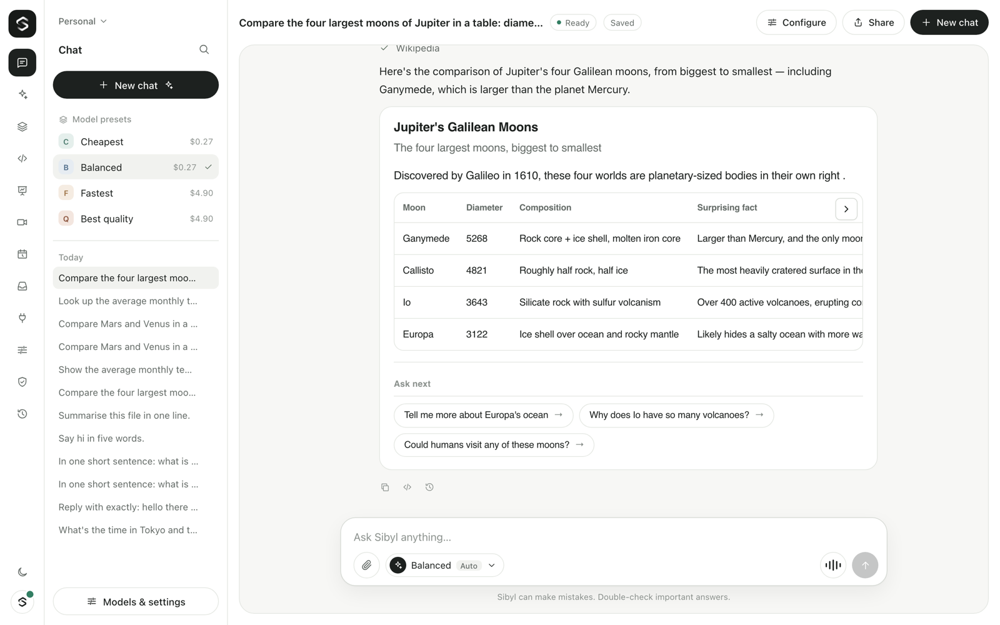
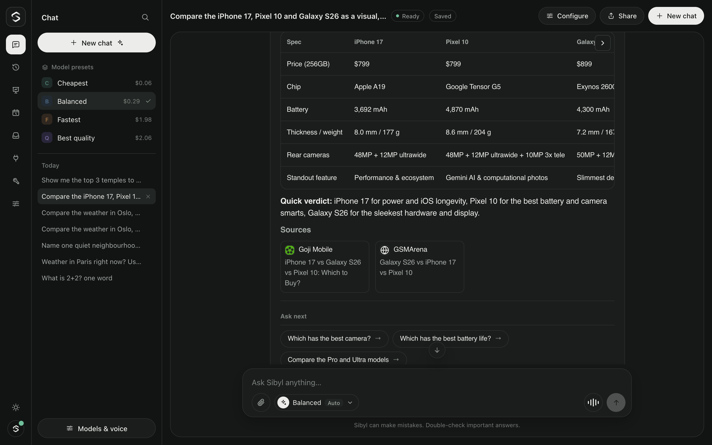
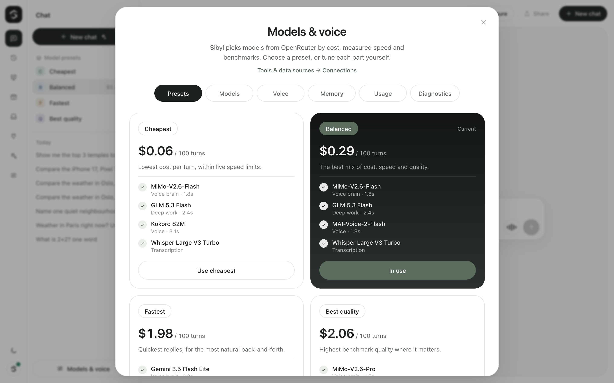
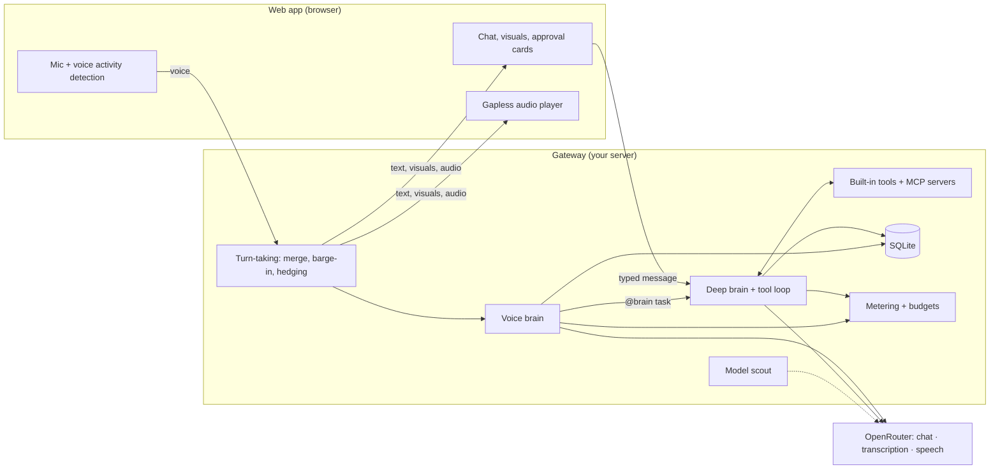

<p align="center">
  
</p>

<h1 align="center">Sibyl</h1>

<p align="center">
  <strong>Talk naturally. Sibyl listens, thinks, and shows you.</strong>
</p>

<p align="center">
  <a href="docs/getting-started.md">Get started</a> ·
  <a href="docs/voice.md">Voice</a> ·
  <a href="docs/tools.md">Tools &amp; MCP</a> ·
  <a href="docs/models-and-costs.md">Models &amp; costs</a> ·
  <a href="docs/configuration.md">Configuration</a> ·
  <a href="docs/deployment.md">Deployment</a> ·
  <a href="#roadmap">Roadmap</a>
</p>

Sibyl is an open-source assistant you host yourself. Talk to it or type to it, and it answers with interactive visuals, researches the web, works with your own tools and data through MCP, and asks before it changes anything. One OpenRouter key is all you need to start; there is no other service behind it.



## What Sibyl does

**Talk or type, in one conversation.** Type and you get a normal chat reply: text and visuals, nothing read aloud. Turn on the mic and you get a live voice conversation: an audio-native *voice brain* hears your tone and pauses, answers out loud in a second or two, and hands harder work to a *deep brain*. Switch between typing and talking whenever you like; it is the same conversation.

**Answers you can see and use.** Replies can include charts, tables, step-by-step plans, option cards and forms, built with [OpenUI](https://github.com/thesysdev/openui). Buttons and forms send your choice straight back to Sibyl. Visuals are never read aloud.



**Real work, with your approval.** The deep brain can call tools: search the web, read a webpage, check the weather, convert currencies, look up world time, calculate and search Wikipedia. Connect your own data sources and tools through any [MCP](https://modelcontextprotocol.io) server. Anything that sends, creates, deletes or spends pauses for an approval card in the chat first.

**A natural voice.** Emotion cues like `[laughs]` are performed by voices that support them. Talk over Sibyl and it stops. Pause mid-thought and it waits for the rest. Slow providers are hedged with a backup request, and audio plays without gaps.


**Predictable costs.** A built-in *model scout* picks every model from the live OpenRouter catalog by price, Design Arena benchmarks and measured speed. Choose a preset — **Cheapest**, **Balanced**, **Fastest** or **Best quality** — and see the estimated cost per 100 turns before you commit. Every call is metered with the cost OpenRouter reports, and daily and monthly budgets stop spending before it happens.



**Yours to keep.** Conversations are stored on your server in SQLite and can be picked up again with full context. A single owner token keeps the gateway private. The web app has searchable history, a composer that queues follow-ups while Sibyl is answering, a quick model menu, light and dark themes, and a layout that works on phones.

## Quickstart

You need Node.js 22.13 or newer and an [OpenRouter](https://openrouter.ai/keys) API key. pnpm comes through corepack, which ships with Node.

```bash
git clone https://github.com/Suryanandx/sibyl.git
cd sibyl
corepack enable
corepack pnpm install
cp .env.example .env        # then set OPENROUTER_API_KEY
corepack pnpm dev
```

Open <http://localhost:3000>. Type a message, or tap the mic button and start talking (hold it instead for push-to-talk).

On the first start the model scout probes the catalog in the background, which takes about a minute. Sibyl is usable right away on the models in `models.config.example.json` and switches to the scout's picks when they are ready. The full walkthrough is in [docs/getting-started.md](docs/getting-started.md).

### With Docker

```bash
cp .env.example .env        # set OPENROUTER_API_KEY and SIBYL_OWNER_TOKEN
docker compose up --build
```

This starts the web app on port 3000 and the gateway on port 8787. For a public deployment behind TLS, see [docs/deployment.md](docs/deployment.md).

## How it works

Sibyl has two processes: a Next.js **web app** for the microphone, playback and interface, and a Node **gateway** that owns every credential, runs the models and tools, and stores your conversations. They talk over one WebSocket with a small, validated JSON protocol.



- **Typed messages** go to the deep brain, which can use tools and replies in text and visuals.
- **Spoken turns** go to the voice brain. It hears your audio and answers out loud; when a request needs careful work, it says something like "let me pull that up" and hands the task to the deep brain, whose visual streams in followed by a short spoken summary.
- A transcription model writes an accurate transcript of what you said in the background, and both brains share the whole conversation.

Typical timings, measured end to end in the browser on the Balanced preset: about **2.5–3.3 s** from the end of your speech to Sibyl's voice, and about **0.5 s** from talking over Sibyl to silence. See [docs/voice.md](docs/voice.md).

More detail: [architecture](docs/architecture.md) · [voice and turn-taking](docs/voice.md) · [generative UI](docs/generative-ui.md) · [tools, MCP and approvals](docs/tools.md) · [WebSocket protocol](docs/protocol.md).

## Models and costs

Every model call goes through OpenRouter: the voice brain, the deep brain, transcription, speech and web search. With `MODEL_SELECTION=auto` (the default with OpenRouter) the model scout chooses them; with `manual` Sibyl uses only the models you list in `models.config.json`.

An example run of the scout (2026-11-09):

| Preset | Voice brain | Deep brain | Voice | Approx. per 100 turns |
|---|---|---|---|---|
| Cheapest | Gemini 2.5 Flash Lite | GLM 5.3 Flash | Kokoro | $0.07 |
| Balanced | MiMo v2.6 Pro | GLM 5.3 Flash | Kokoro | $0.13 |
| Fastest | Gemini 3.1 Flash Lite | GLM 5.3 | Kokoro | $0.19 |
| Best quality | MiMo v2.6 Pro | GLM 5.3 Flash | Gemini 3.8 Flash TTS | $0.36 |

Picks change as prices, benchmarks and provider speed change. Set `SIBYL_BUDGET_DAILY_USD` and `SIBYL_BUDGET_MONTHLY_USD` to cap spending, and check the **Usage** tab for what you have spent. See [docs/models-and-costs.md](docs/models-and-costs.md).

## Configuration

Sibyl reads one `.env` file at the project root. Only `OPENROUTER_API_KEY` is required. The settings you are most likely to change:

| Setting | What it does |
|---|---|
| `SIBYL_OWNER_TOKEN` | Require this token to use the gateway. Set it for anything beyond your own laptop. |
| `SIBYL_DATA_DIR` | Where the SQLite database lives |
| `SIBYL_BUDGET_DAILY_USD`, `SIBYL_BUDGET_MONTHLY_USD` | Spending caps |
| `SIBYL_MCP_CONFIG` | Path to your `mcp.config.json` |
| `MODEL_STRATEGY` | Default preset: `cheapest`, `balanced`, `fastest` or `best` |
| `ALLOWED_ORIGINS` | Browser origins allowed to connect to the gateway |
| `NEXT_PUBLIC_GATEWAY_WS_URL` | Where the browser finds the gateway (build time) |

Every variable, with its default, is in [docs/configuration.md](docs/configuration.md).

## Privacy

Sibyl has no hosted service of its own. Here is where your data goes:

- **Your voice** goes from the browser to your gateway, which forwards it to OpenRouter for the voice brain and for transcription. OpenRouter routes it to the provider behind the model you are using.
- **Text and conversation history** go to OpenRouter for the voice brain and deep brain. Reply text goes to the speech model you selected.
- **Tool calls** reach the services they are built on: web search through OpenRouter, weather from Open-Meteo, exchange rates from Frankfurter, and Wikipedia. Reading a webpage fetches that page from your server. MCP servers receive whatever the deep brain sends them.
- **Instant captions** while you speak come from the browser's own speech recognition. In Chrome this is processed by the browser vendor's service. They are only a display hint; turn them off with `NEXT_PUBLIC_LIVE_CAPTIONS=false`.
- **Conversations, approvals and usage records** are stored in SQLite on your server (`SIBYL_DATA_DIR`). Nothing is stored anywhere else.
- **API keys** stay on the gateway. The browser never sees them.
- **Gateway logs** are structured JSON and redact fields that look like credentials, audio, transcripts or message content.

Check each provider's data policy on OpenRouter if this matters for your use. A self-hosted deployment is only as private as the providers you route to.

## Roadmap

Next:

- **Slides.** Make presentations through a self-hosted Presenton service, inside slides-only Spaces with a library, preview, PPTX and PDF export, and revisions.
- **Routines.** Scheduled jobs that run on their own, with an approval inbox for anything they want to change and per-routine budgets.
- **Memory** that carries across conversations.
- **File uploads** in chat.
- **A Connections screen** to add and manage MCP servers from the web app.

Ideas and feedback are welcome in [GitHub issues](https://github.com/Suryanandx/sibyl/issues).

## Contributing

Bug reports, fixes, latency measurements and documentation improvements are all welcome. Read [CONTRIBUTING.md](CONTRIBUTING.md) for setup and the checks to run, and [SECURITY.md](SECURITY.md) for reporting vulnerabilities privately. Everyone taking part agrees to the [Code of Conduct](CODE_OF_CONDUCT.md). Release notes are in [CHANGELOG.md](CHANGELOG.md).

## License

Sibyl is released under the [MIT License](LICENSE).
