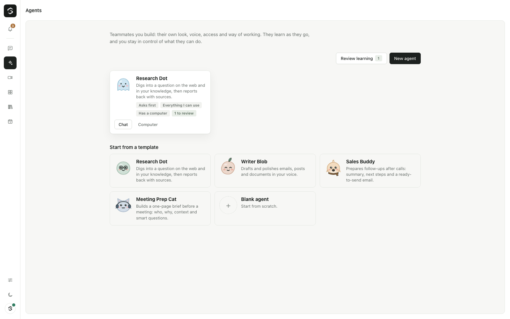
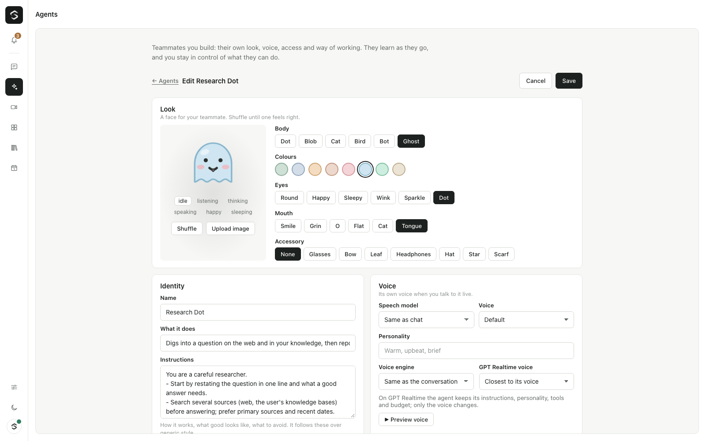

# Agents

Agents are teammates people build themselves: a name, a generated avatar, a
voice, instructions, and settings for **access**, **autonomy**, **learning**
and **budget**. They run on Sibyl's own brain, with the same tools, skills,
knowledge, approvals and budgets as everything else — there is no second agent
runtime. An agent only shapes one brain call; the gateway enforces the rest.

## Using an agent

- **Composer:** the "Ask Sibyl ▾" chip picks who answers (`agent.select`, which
  also applies to live voice turns). The choice sticks for the connection.
- **Mention:** start a message with `@Sales Buddy …` (also `@SalesBuddy`,
  `@sales-buddy`). The mention is removed before the model sees the text.
- **Per message:** `user.text` and `vad.speech_start` take an optional `agentId`.
- **Routines:** a routine with `agentId` runs as that agent (its prompt,
  access, autonomy and budget). An agent creating a routine makes it run as itself.
- A turn answered by an agent is announced with `agent.turn {requestId, agentId,
  name, avatar}` so the chat can show the agent's face next to the reply.

What changes during an agent's turn:

| | |
|---|---|
| System prompt | `## You are <name>`, its instructions, curated memory (≤ 2,000 chars), its skills (name + description), its knowledge bases, how it may act |
| Tools | filtered by access (below), plus `agent_recall` (search its memory and past runs), `agent_skill` (load one of its skills), `agent_knowledge_search` (only its bases), `agent_remember` (unless learning is off) |
| Model | `modelPreset`: a catalog preset id (its `llmModel`) or a model id; otherwise the chat model |
| Voice | `voice.ttsModel` / `voice.ttsVoice` when the catalog offers them (also for spoken deep-work gists); `voice.style` goes into the voice prompt |

## Access — never more than the creator

- **Everything I can use** (`inherit`, default): every tool the creator may use
  in the workspace. It is checked with `authorize()` on the creator's
  *current* principal at the start of each turn and again when each call runs,
  so an agent's access shrinks the moment its creator loses rights. A disabled
  or deleted creator leaves the agent with no tools.
- **Controlled:** the intersection of the above with allowlists: tool names,
  connectors (a tool's `provider`, all its actions), knowledge bases, skills and
  secrets. A call that references `${secret:NAME}` outside the list is refused.
- The **person talking** to a shared agent is checked too: a viewer can't run
  writes through an admin's agent.
- Tools receive `context.agent = { id, knowledgeBaseIds?, skillIds? }` so
  knowledge and skill tools can stay inside a controlled agent's lists.

## Autonomy

| Setting | Write actions |
|---|---|
| `ask_first` (default) | approval card for every write |
| `act_then_tell` | run without a card; an `agent_action` notification goes to the Inbox afterwards |
| `autonomous` | run within budget, no card |

**High-risk actions always ask**, whatever the setting: tools tagged
`risk: "high"` on their `ToolDefinition` (new, optional) and write tools whose
names contain delete / remove / pay / transfer / refund / purchase / share /
publish / invite / grant (see `HIGH_RISK_NAME` in `apps/gateway/src/agents/access.ts`).

## Budgets

`budget: { dailyUsd?, monthlyUsd? }` per agent, on top of the organization's
caps. Every model call of an agent's run is bound to it (`meter.bindAgent`),
so tool loops, plain replies, speech and reflection all count. Before each
turn (and each routine round) the meter checks the agent's caps; at the cap
the agent pauses with `budget.blocked` (scope `daily`/`monthly` in the
browser) until the next day or month. Spend is kept in `kv` and restored on start.

## Its own computer

`computer: { enabled, idleMinutes?, dailyMinutes? }` gives the agent a
sandboxed browser with a file area. The `computer_*` tools are offered only
to agents with it on (`isAvailable` sees the agent through `usableTools`),
and they follow the agent's access and autonomy like any other tool. See
[agent-computers.md](agent-computers.md).

## Learning

Inspired by Hermes Agent (Nous Research, MIT): skills written from
experience as Markdown, curated memory, and search over past sessions.

1. After every run the agent writes a short **run log** (task, steps, answer)
   into its memory; `agent_recall` searches it (FTS5 in SQLite).
2. After a run with **≥ 3 tool steps**, or when the user says something like
   "that's how we do it", one **cheap reflection call** (the Cheapest preset's
   model, metered against the agent) decides whether to propose a **new skill**,
   an **edit** to one, and/or **memory** lines.
3. `learning: "ask_first"` (default) stores them as `SkillProposal`s for review
   (Agents → Review learning: approve as is, edit then approve, or reject).
   `"automatic"` applies them straight away — except edits to skills people
   wrote, which still wait. `"off"` skips learning.
4. Applied skills are `SkillRecord`s with `source: "agent"`, `agentId` and a
   version; edits keep the previous version on the proposal. Every applied
   change can be **rolled back** (new skill removed, edit restored, memory removed).

## Permissions

| Permission | Who (built-in roles) | Allows |
|---|---|---|
| `agents.use` | Viewer and up | see and use agents visible to you |
| `agents.create` | Member and up | create private agents; edit and delete your own |
| `agents.share` | Admin, Owner | share agents with the workspace; edit or delete anyone's |

Private agents are visible only to their creator.

## WebSocket protocol (`/* ── Agents (v0.4) ── */`)

Client → gateway: `agents.request`, `agent.get {agentId}`, `agent.save {agent}`,
`agent.delete {agentId}`, `agent.select {agentId|null}`,
`agent.proposals.request {agentId?}`, `agent.proposal.decide {proposalId,
decision: approve|reject|rollback, skill?, memory?}`, `agent.memory.request
{agentId}`, `agent.memory.save {agentId, itemId?, text}`, `agent.memory.delete
{agentId, itemId}`, `agent.voice.preview {requestId, ttsModel?, ttsVoice?, name?}`.

Gateway → client: `agents.list {items, templates, selectedAgentId?, canCreate,
canShare}`, `agent.detail {agent, memory, proposals}`, `agent.saved {agent}`,
`agent.proposals {agentId?, items}`, `agent.memory {agentId, items}`,
`agent.turn {requestId, agentId, name, avatar}`, `agent.voice.sample
{requestId, mimeType, audio}`.

## Avatars

`packages/core/src/avatar.ts` (also `@open-gpt-live/core/avatar` for the web):
deterministic SVG characters (dot, blob, cat, bird, bot, ghost, or an uploaded
image) from Sibyl palettes, with eyes, mouth and an accessory.
`renderAvatarSvg(spec, { mood, size, title })` animates six moods (idle,
listening, thinking, speaking, happy, sleeping); `randomAvatar(seed)` and
`normalizeAvatar(input)` keep everything valid. No image model, no cost.

## Storage

Collections `agents`, `agentMemory` (with keyword search) and `skillProposals`
in both stores; SQLite migration "agents" adds `agents`, `agent_memory`,
`agent_memory_fts` and `skill_proposals`.

## Web

`apps/web/features/agents`: `useAgents(client)`, `AgentsScreen`, `AgentEditor`
(avatar studio, voice with preview, access pickers, autonomy, learning,
budget, visibility, memory), `AgentProposals`, `AgentAvatar`, `AgentPicker`.
See the header of `features/agents/index.ts` for how to mount them.

Agents also work in Slack and Teams channels: see [slack-and-teams.md](slack-and-teams.md).

## Not yet

- The brain handing a sub-task to an agent ("ask Sales Buddy to draft …").
- Agent computers (sandboxed browser) (wave C).

- Slack/Teams presence (wave C).
- Enterprise approval policies and audit of agent actions.
