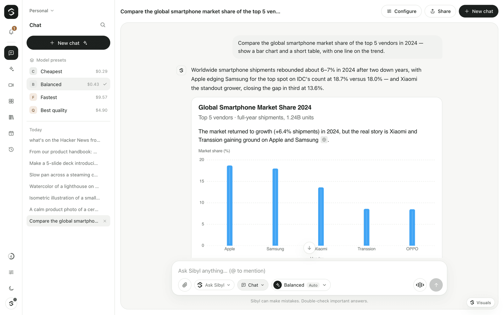

# Generative UI

Some answers are easier to see than to hear. Alongside its spoken reply, Sibyl can put a visual on screen: a chart, a table, a step-by-step plan, option cards or a short form. Visuals are written by the model in [OpenUI](https://github.com/thesysdev/openui)'s `openui-lang` and rendered in the browser with OpenUI's chat component library (`@openuidev/react-ui`).



## When visuals appear

- **Typed messages** are answered by the deep brain directly: text plus, when it helps, one visual.
- **In voice mode**, visuals come from the deep brain too. The voice brain hands off a task with `@brain`, and the deep brain answers with a short spoken gist and the visual.
- In single-model mode (no voice brain), the chat model writes both the spoken part and the visual.
- Greetings, small talk and short factual answers stay spoken only.

Visual answers are on by default. Turn them off for everyone with `GENUI_ENABLED=false`, or per browser with **Visual answers** in Settings → Voice (`/settings/voice`). Without visuals the deep brain is asked for plain spoken text.

## The response contract

Every reply has two parts, in this order:

1. **A spoken part** — one to three short, plain sentences that make sense without looking at the screen. No markdown, lists, code or URLs. When there is a visual, the speech gives the key takeaway instead of reading values aloud.
2. **An optional visual** — exactly one fenced block tagged `openui-lang`, containing one complete program:

````text
We found three good options; the train is cheapest and only an hour slower.

```openui-lang
root = Card([...])
...
```
````

The model is told to write nothing after the closing fence.

## How the gateway splits the stream

The gateway separates speech from the visual as tokens arrive (`SpeechUiSplitter` in `packages/genui`):

- Text outside a fence is speech. It is streamed to the browser as text and to the speech model in segments.
- Text inside a fence is the visual. It is streamed as `ui.delta` events and rendered progressively. **Fenced code is never sent to speech.**
- If a model forgets the fence and starts a line with `root =`, the rest of the reply is treated as the visual.
- Anything written after the visual (self-corrections, stray notes) is dropped. A second fenced program replaces the first, so a corrected version wins.
- Markdown symbols are stripped from the spoken text before speech.

## Design rules

On top of OpenUI's component reference, the prompt includes design rules that take priority. In short:

- **Fit one screen.** At most 8 top-level children and about 60 statements.
- **One primary structure per answer:**
  - comparisons → a table (up to 6 rows and 5 columns);
  - numbers over time or by category → one chart, with at most 3 key figures;
  - multi-part plans → tabs, one per day or phase, each with up to 4 steps;
  - how-tos → up to 6 steps;
  - a few recommendations → a short list or option cards;
  - gathering preferences → a form with up to 4 fields, structured inputs and sensible defaults.
- **Short content.** A title of six words or fewer, short text blocks, concrete values over adjectives, no filler sections.
- **Real interactions only.** Every button either sends a clear action back to Sibyl or opens a real URL it was given. At most three follow-up actions. Forms have one primary submit button, labelled with the outcome.

The full rules are `VISUAL_DESIGN_RULES` in `packages/genui/src/index.ts`.

## Interacting with a visual

- **Buttons and forms** that continue the conversation become a new user turn. It shows in the conversation as the button's label and is sent to the model as `[UI action] <label>`, followed by the form values when a form was submitted.
- **Links** open in a new tab, and only `http` and `https` URLs are allowed.
- If a visual can't be rendered, the browser shows "This visual could not be rendered." and the rest of the reply is unaffected.

Each assistant reply also has buttons to copy the reply, show the visual's source and ask again. Saved conversations keep their visuals, so you can reopen them from the history.

## Theming

Visuals use Sibyl's light and dark themes through OpenUI's theme provider, including pop-ups such as selects and date pickers. They follow the theme you choose in the rail.

## Updating the component library

The gateway embeds the exact component prompt that matches the browser's renderer. After upgrading `@openuidev/react-ui`, regenerate it:

```bash
corepack pnpm --filter @open-gpt-live/genui generate
```

This rewrites `packages/genui/src/openui-library-prompt.generated.ts`. Commit it with the upgrade.

## Notes

- `@openuidev/react-headless` has an optional import of the Vercel AI SDK. Sibyl streams over its own WebSocket, so `apps/web/next.config.mjs` stubs that import out.
- The postinstall script of `@openuidev/lang-core` only sends telemetry, so it is disabled in `pnpm-workspace.yaml` (`allowBuilds`).

## Debugging visuals

Sibyl has its own **Visual inspector** (`apps/web/components/VisualInspector.tsx`). It listens to `@openuidev/observability`, the in-page event bus the OpenUI renderer reports to. Nothing leaves the browser. For each generated visual it shows:

- parse and render errors and warnings (incomplete programs, unresolved references, unused statements);
- the raw OpenUI Lang source, with a copy button;
- timing, and the model when an event carries one.

It is always on in development (`next dev`): open it with the small **Visuals** button in the bottom-right corner. In a production build, turn it on per browser in **Settings → Diagnostics → Visual inspector**.

`@openuidev/react-lang` would otherwise auto-mount the third-party OpenUI devtools overlay in development. Sibyl turns that off twice: the inline head script in `apps/web/app/layout.tsx` sets the `openui.devtools.autoMount` flag before the renderer loads, and `apps/web/next.config.mjs` aliases `@openuidev/devtools` to an empty module.
