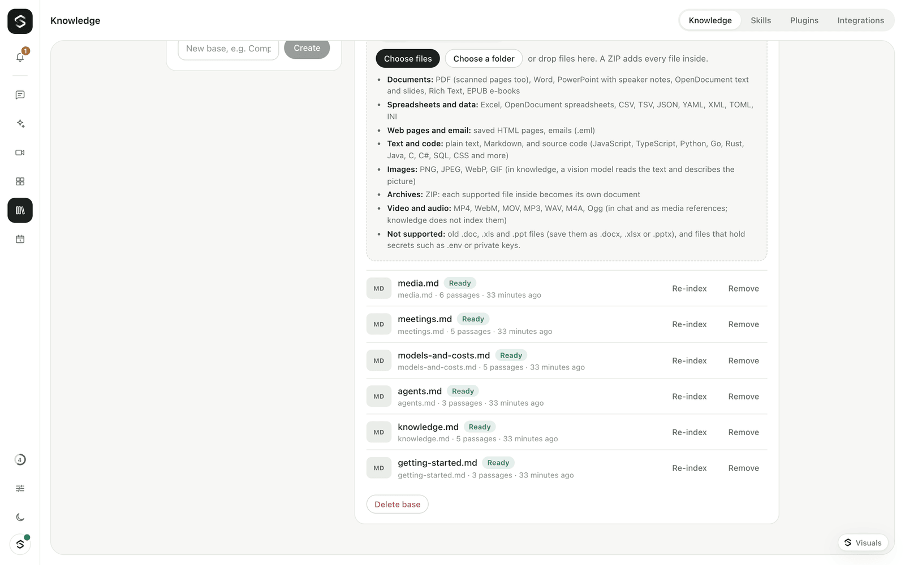
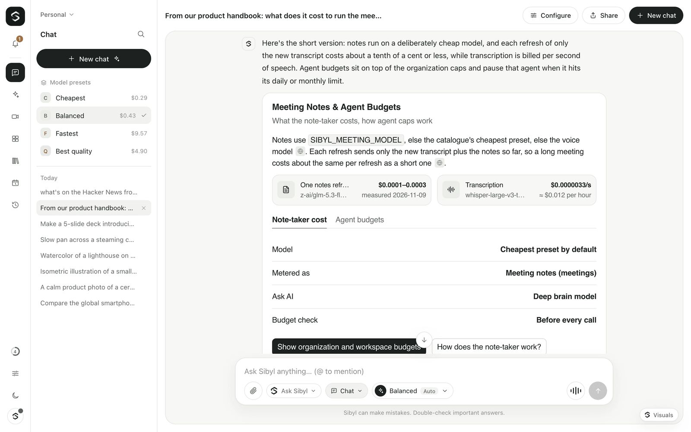

# Knowledge bases

A knowledge base is a set of documents — uploaded files, web pages and pasted
text — that Sibyl searches and cites. Bases belong to a workspace.

## Adding documents

| Source | How it is read |
|---|---|
| File | The upload pipeline (`/api/uploads`, the same one chat attachments use). See the table of formats below. |
| Several files, a folder or a ZIP | The web app uploads many files at once (or a whole folder) with a progress list. A ZIP adds one document per supported file inside; the rest are listed as skipped. |
| Web page | The same fetcher as the `read_webpage` tool: public http(s) only, private/local addresses refused at every redirect, 2 MB / 15k characters. |
| Pasted text | Up to 500,000 characters. |

Adding returns at once with status **pending**. A background queue then
extracts, splits and indexes the document (**indexing** → **ready** or
**failed**, with the reason). Documents left pending by a restart are
re-queued (pasted text cannot be recovered and is marked failed). Files and
pages can be re-indexed. Each document shows its type, its pages, slides,
sheets or chapters, its status, and for images and scans the model that read
it and what that cost.

**Chunking:** ~800 tokens (estimated at 4 characters/token) with ~100 tokens
of overlap, split at paragraphs, then sentences. Each chunk keeps the nearest
Markdown heading and its page, slide, sheet, chapter or file as its label, so
citations read `Handbook.pdf › Page 4 · Expenses` or `Deck.pptx › Slide 3`.

## Supported files

One list of formats (`FILE_FORMATS` in `packages/protocol`) is shared by the
gateway and the web app's file pickers. The gateway decides the type from the
bytes and the extension, never from what the browser says.

| Kind | Extensions | What is indexed |
|---|---|---|
| PDF | `.pdf` | Text of every page (`--- Page N ---`). A PDF with no text layer (a scan) is read by OCR, see below. |
| Word | `.docx` | Paragraph text. |
| PowerPoint | `.pptx` | Slide text and speaker notes, slides in presentation order (`--- Slide N ---`). |
| Excel | `.xlsx` | Every sheet as CSV (`--- Sheet: name ---`). |
| OpenDocument | `.odt`, `.ods`, `.odp` | Text with headings; sheets as CSV; slides with speaker notes. |
| EPUB | `.epub` | Chapters in reading (spine) order (`--- Chapter N ---`). |
| Rich Text | `.rtf` | Text with control words and formatting removed. |
| HTML | `.html`, `.htm` | Readable text, from the same converter as the `read_webpage` tool. |
| Email | `.eml` | Subject, from, to, cc, date, the text part (or the HTML part as text), and the names of attachments. |
| Data | `.csv`, `.tsv`, `.json` | A short summary (columns, first rows / shape) and the full content. |
| Config | `.yaml`, `.yml`, `.xml`, `.toml`, `.ini`, `.cfg` | As text. |
| Text | `.txt`, `.md`, `.markdown`, `.mdx`, `.log`, `.rst`, `.tex` | As text. |
| Source code | `.js`, `.ts`, `.tsx`, `.jsx`, `.py`, `.go`, `.rs`, `.java`, `.kt`, `.swift`, `.rb`, `.php`, `.c`, `.h`, `.cpp`, `.cs`, `.sh`, `.sql`, `.css`, `.scss`, `.vue`, `.svelte` and more | As text, with the language named ("Python source file app.py"). |
| Images | `.png`, `.jpg`, `.jpeg`, `.webp`, `.gif` | In knowledge: a vision model writes down the text in the image and a short description. In chat: the image goes to the model as is. |
| ZIP | `.zip` | In knowledge: one document per file inside. In chat: the text of every readable file inside. |

**Never accepted:** files that usually hold secrets (`.env`, `.env.*`,
`*.pem`, `*.key`, `id_rsa`, `credentials.json`, `secrets.yaml`, `.npmrc`,
service-account JSON and similar), executables and anything not listed above.
Folder uploads also leave out hidden files and folders (`.git`, `.DS_Store`).

**Old Office files (`.doc`, `.xls`, `.ppt`)** are refused with the message
"save as .docx / .xlsx / .pptx". We looked for a parser and found none that
is small, maintained and safe: the npm `xlsx` package (SheetJS) stopped
publishing to npm at 0.18.5 and that version has known advisories (prototype
pollution, ReDoS); its fixed builds are only on SheetJS's own CDN, and
re-publishes such as `@e965/xlsx` are unofficial; `word-extractor` (`.doc`)
was last released in 2022; there is no maintained JavaScript `.ppt` reader.
Parsing these binary formats means trusting a large, old code path with
untrusted files, so Sibyl asks for the modern format instead.

### Images and scanned PDFs (OCR)

Knowledge reads text that only exists as pixels with a model, through the
same provider as chat (OpenRouter):

- **Images:** a vision model transcribes all visible text and adds a one to
  three sentence description, so screenshots, photos of whiteboards and
  scanned receipts become searchable.
- **Scanned PDFs** (no text layer): OpenRouter's `file-parser` plugin with the
  `mistral-ocr` engine reads the PDF; its text comes back as a file annotation,
  so the model only answers "OK". If that fails or returns nothing, the model
  reads the PDF itself (engine `native`, models with file input only). If both
  fail, the document fails with both reasons.

**Model:** `SIBYL_OCR_MODEL`, else `SIBYL_VISION_MODEL`, else the cheapest
image-reading model in the current model catalog (from the model scout or
`models.config.json`), judged by OpenRouter's model data (input modalities
and per-token prices). Set `SIBYL_OCR_MODEL` if you prefer a stronger model.

**Costs** (measured on OpenRouter, November 2026):

| What | Cost |
|---|---|
| Scanned PDF, `mistral-ocr` | about **$0.002 per page** (OpenRouter's price is $2 per 1,000 pages; measured $0.00201 for 1 page and $0.00401 for 2 pages, including the model's few tokens) |
| Image, cheapest vision model in the catalog (`deepseek/deepseek-v4.1-flash`) | about $0.00004–$0.00015 per image |
| Image, `anthropic/claude-sonnet-5.5` | about $0.0024–$0.0026 per image |

Every call checks the budget first and is metered as **`knowledge_ocr`** with
the provider-reported cost (it includes the parser's per-page fee). The cost
shows in the document's details and under Settings → Usage. When a budget is
reached, the document fails with "Budget reached, so the image was not read"
and the budget message, and nothing is sent. The text read by the model is
kept next to the upload, so re-indexing does not pay again.

Notes: a PNG with a transparent background can look solid black to some
models (the text is then missed); a screenshot or a JPEG works best. Images
and PDFs larger than 30 MB are not sent for OCR. `SIBYL_KNOWLEDGE_OCR=false`
turns OCR off: images are then refused and scans fail with a clear reason.
Chat attachments never use OCR: images go to the chat model directly.

### Limits

- Each file: `SIBYL_UPLOAD_MAX_MB` (default 20 MB), also for every file inside a ZIP.
- A ZIP: at most 200 files, and at most 10 × the per-file limit (at least
  200 MB) unpacked in total. Every entry is unpacked with a size cap, so a
  "zip bomb" stops at the limit. Encrypted entries and ZIPs inside ZIPs are skipped.
- Extracted text: at most 2,000,000 characters per file.
- The web app uploads 3 files at a time and up to 1,000 files per pick or folder.

Limits: 100 bases per workspace, 1,000 documents per base, 5,000 chunks per document.

## Search

- **Keyword (always on):** SQLite FTS5 (`porter unicode61`), bm25 ranking.
  Needs no configuration.
- **Hybrid (optional):** set `SIBYL_EMBEDDINGS_MODEL` (for example
  `openai/text-embedding-3-small`). Chunks are embedded when indexed through
  the provider's OpenAI-compatible `POST /embeddings` (OpenRouter supports it,
  same key as the LLM; `SIBYL_EMBEDDINGS_BASE_URL` overrides the URL).
  Results are ranked `0.5 × keyword (normalised) + 0.5 × cosine`. Every
  embeddings call checks the budget first and is metered (feature `tool`): the
  provider-reported cost, else `SIBYL_EMBEDDINGS_USD_PER_MTOK` (default
  $0.02 per million tokens). If an embeddings call fails, keyword search still works.

## How the assistant uses knowledge

- `search_knowledge` (read) — query plus optional base ids; returns passages
  with `[document › section]` citations.
- `list_knowledge` (read) — the workspace's bases.
- `save_to_knowledge` (write, needs approval) — saves a chat attachment into a base.

**Searched automatically:** a workspace setting (`WorkspaceRecord.knowledgeBaseIds`,
or a kv fallback for a default workspace without a record). For those bases
the deep brain and typed chat get a short **Relevant knowledge** block on
every turn: a keyword-only search for the latest user message, at most 4
snippets and ~1,800 characters (≈450 tokens), nothing when nothing matches.
No embeddings calls are made for this block. The live voice model does not get it.

## Permissions

| Action | Permission |
|---|---|
| Read bases, documents, search | `knowledge.view` |
| Add / remove / re-index documents, save an attachment | `knowledge.edit` |
| Create, rename, delete bases | `knowledge.manage` |
| Choose the automatically searched bases | `workspace.settings` |

The tools check the same permissions for the signed-in person (routines act for the owner).

## HTTP API

All routes act in the request's workspace (`x-sibyl-workspace`, default `default`).

| Route | Body / query | Returns |
|---|---|---|
| `GET /api/knowledge` | | `{ bases, autoBaseIds, embeddings }` |
| `POST /api/knowledge` | `{ name, description? }` | `{ base }` |
| `GET /api/knowledge/:id` | | `{ base, docs }` (poll while indexing) |
| `PATCH /api/knowledge/:id` | `{ name?, description? }` | `{ base }` |
| `DELETE /api/knowledge/:id` | | `{ ok }` |
| `POST /api/knowledge/:id/docs` | `{ kind: "upload", uploadId }` · `{ kind: "url", url }` · `{ kind: "text", title, text }` | `{ doc, docs, skipped }` (a ZIP upload: one doc per file inside, `skipped` lists the rest with reasons) |
| `DELETE /api/knowledge/:id/docs/:docId` | | `{ ok }` |
| `POST /api/knowledge/:id/docs/:docId/reindex` | | `{ doc }` |
| `GET /api/knowledge/search` | `?q=&base=a,b&limit=` | `{ query, hits, mode }` |
| `PUT /api/knowledge/settings` | `{ autoBaseIds }` | `{ autoBaseIds }` |
| `POST /api/knowledge/save-upload` | `{ uploadId, knowledgeBaseId? }` | `{ base, doc }` |

Response types are in `packages/protocol` (`KnowledgeBaseView`, `KnowledgeDocView`, `KnowledgeAddDocsResponse`, `KnowledgeHitView`).
`KnowledgeDocView` carries `fileKind`, `parts` (`{ unit: "page" | "slide" | "sheet" | "chapter" | "file", count }`)
and, for images and scans, `ocr` (`{ model, engine?, costUsd, estimated }`).

## Web

`apps/web/features/knowledge` exports `KnowledgeScreen` (bases, documents with
type, parts, status and OCR cost, add files / a folder / a ZIP / a URL / text
with a per-file progress list, cited search) and `SaveToKnowledgeButton` (one-click
save for a chat attachment: `<SaveToKnowledgeButton uploadId={id} />`).
