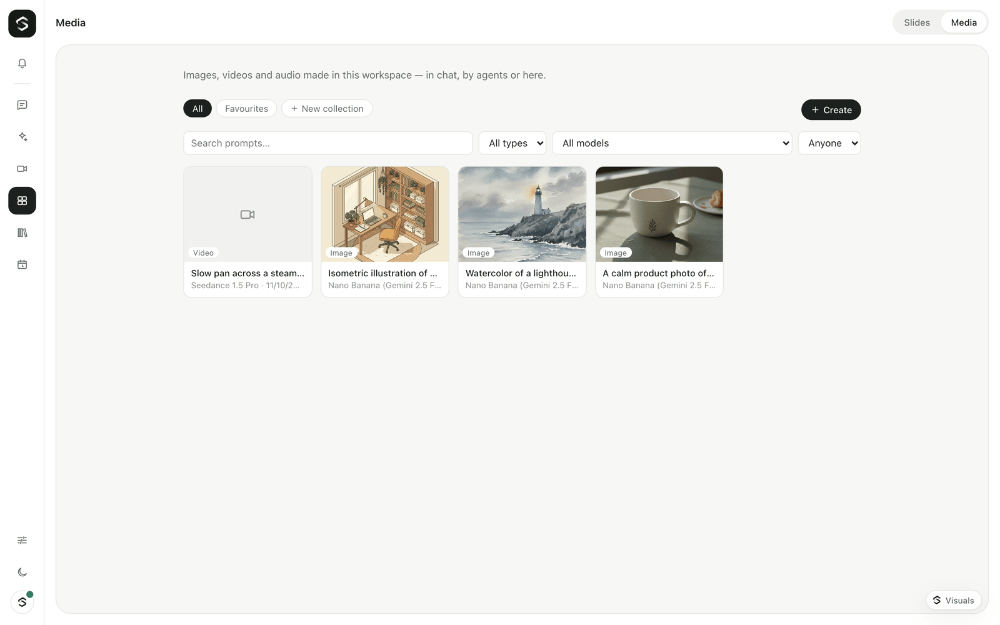

# Media: images, video and audio

Sibyl makes images, short videos, voice-overs and music with the media models on OpenRouter. Chat is where you make them; **Spaces → Media** is the library where everything made in the workspace is kept.

One OpenRouter key runs all of it (`OPENROUTER_API_KEY`). There is no separate setup.

## Making media in chat

There are two ways, and both end in the same place.

- **Create mode.** In the composer, switch **Chat** to **Image**, **Video** or **Audio**. The pill next to it shows the model and the price of what you are about to make, for example *Seedance 2.0 Fast · ≈$0.17*. Click it for the settings of that model: aspect ratio, resolution, duration, sound, seed, number of images, quality, voice, and so on. The list of settings comes from the model's own listing on OpenRouter, so each model shows what it actually supports. Your choice of model and settings is remembered per workspace in this browser. Type the prompt and send: no chat model is involved, and no approval card is shown (you saw the price).
- **Ask in words.** "Make a 16:9 image of a lighthouse at dusk", "turn @image1 into a 5-second video". Sibyl calls `create_image`, `create_video` or `create_audio`. These tools spend money, so they are write tools, but a call only waits for your approval when its estimate is above `SIBYL_MEDIA_APPROVE_ABOVE_USD` (default $0.25). Most images and voice-overs go straight through; most videos ask first.

The result appears under the reply: an image grid, a video player or an audio player. Click it to open it large in the side panel. While a video renders the card shows *Queued* or *Rendering · about 40%* (an estimate from the model's typical time on OpenRouter). The card's actions:

- **Download** — every file of the result.
- **Use as reference** — adds it to the composer as `@image1` (or `@video1`, `@audio1`).
- **Save to knowledge** — images only; a vision model reads them.
- **Make another** — the same prompt, model and settings again.
- **Remix** — puts the prompt, model, settings and references back in the composer so you can change them.
- **Cancel** — while a video renders (see [Limits](#limits)).
- **Open in Media**, and **Details**: prompt, the prompt as sent to the model, model, settings, references and the cost.

The cost is in the details, not under every reply.

## @ references

Type `@` in the composer to open the picker. It has sections:

- **Agents** — picking one makes it answer the message (the same as typing `@Name` at the start).
- **Media in this chat**, **Files** (attached earlier in the chat), **Recent media** (the workspace library) and **Knowledge** (files in your knowledge bases).

A picked image, video or audio file becomes a chip above the text box and a token in the prompt: `@image1`, `@image2`, `@video1`, `@audio1`, numbered per type in the order you picked them. In Video mode an image chip can be switched from *reference* to *first frame* or *last frame* when the model supports frames. Files you attach with the paperclip in a media mode are references too. A picked document (PDF, spreadsheet) is attached to the message like any file.

Each model family names its inputs differently, so Sibyl rewrites the tokens before sending the prompt (you can see the result as *Sent as* in the details):

| Family | How the prompt names references | Source |
|---|---|---|
| Seedance 2.x (ByteDance) | `@Image1`, `@Video1`, `@Audio1` | fal.ai Seedance 2.0 reference-to-video docs |
| Wan 2.x (Alibaba) | `image 1`, `video 1` (numbered per type, in order) | Alibaba Model Studio reference-to-video docs |
| Other models | `image 1` | — |

A first or last frame reads *the first frame* / *the last frame*.

Limits Sibyl checks before sending:

| Family | Reference images | Reference videos | Reference audio | Notes |
|---|---|---|---|---|
| Seedance 2.0 / 2.0 Fast / 2.0 Mini / 2.5 | 9 | 3 | 3 | At most 12 files; audio needs at least one image or video. Videos 2–15 s together, audio ≤15 s together (ByteDance limits). |
| Wan 2.6, 2.7, 3.0 | 5 (images and videos together) | — | — | Sibyl sends Wan only image references (OpenRouter documents no video input for it). |
| Image models | as listed by OpenRouter (`input_references`), e.g. 14 for Gemini image models, 4 for FLUX.2 Klein | — | — | |

Frames and references can't be combined: OpenRouter then ignores the references.

## Spaces → Media (the library)

Everything made in the workspace — in chat, by agents or through the API — is saved automatically with its prompt, model, settings, references, cost, who made it and the chat it was made in. Open it at `/media`.

- Search prompts; filter by type, model and who made it.
- **Favourites** (yours) and **collections** (shared in the workspace): create, rename, delete a collection; add or remove an item from the detail view. Deleting a collection keeps its media.
- The detail view (`/media/<id>`) shows the item large with its details, **Download**, **Use in chat** (opens the chat it was made in — or a new one — with the item as an `@` reference), **Remix in chat** (the composer prefilled with its prompt, settings and references), **Open its chat** and **Delete** (the person who made it, or someone who can see every chat).
- **Create** opens chat in Image, Video or Audio mode. There is no second creation screen.

Generated files are ordinary uploads: they can be attached, referenced, saved to knowledge (images) or used in slides.

## Models and parameters

The catalogue is read from OpenRouter, never hard-coded, and refreshed every six hours:

| Listing | What Sibyl takes from it |
|---|---|
| `GET /api/v1/videos/models` | durations, resolutions, aspect ratios, sizes, first/last frame support, sound, seed, pricing SKUs, passthrough options |
| `GET /api/v1/models?output_modalities=video` | which inputs a video model takes (image, video, audio) |
| `GET /api/v1/images/models` | typed parameters (`aspect_ratio`, `resolution`, `quality`, `n`, `background`, `seed`, `input_references`) |
| `GET /api/v1/images/models/<id>/endpoints` | the price lines (per image, per megapixel or per token) |
| `GET /api/v1/models?output_modalities=speech` | voice-over models, their voices and price per character |
| `GET /api/v1/models?output_modalities=audio` | music models (Lyria); the price per clip is in the listing's description |

Requests go to `POST /api/v1/images` (images, base64 results with `usage.cost`), `POST /api/v1/videos` then `GET /api/v1/videos/<id>` and `/content` (video jobs), `POST /api/v1/audio/speech` (voice-over; the cost is read from `/generation?id=` afterwards) and streamed `POST /api/v1/chat/completions` with `modalities: ["text","audio"]` (music: OpenRouter refuses audio output without `stream: true`). OpenRouter's Images API covers every image model, including the Gemini ones that also answer chat completions with `modalities: ["image","text"]` and `image_config`; Sibyl uses the Images API for all of them because it has the typed parameters and `n`.

On 2026-11-09 this gave 57 image models, 29 video models, 38 voice-over models and 2 music models. Left out on purpose: SVG-only image models (SVG can carry scripts), video edit/upscale/avatar models that need a source video (Runway Aleph, FLUX video edit/upscale, HeyGen avatar), and chat models that merely speak (GPT Audio).

Settings Sibyl shows for video models, when the model lists them: aspect ratio, resolution, duration, sound (`generate_audio`), seed, negative prompt and "enhance prompt" (sent as the provider's passthrough option: `negativePrompt` / `enhancePrompt` for Veo, `negative_prompt` / `prompt_extend` for Wan, `negative_prompt` for Kling). A duration between listed values snaps to the nearest one.

| Video model (examples) | Durations (s) | Resolutions | Frames | Sound | Price |
|---|---|---|---|---|---|
| `bytedance/seedance-2.0-fast` (default) | 4–15 | 480p, 720p | first, last | yes | video tokens: width × height × 24 × seconds ÷ 1024 × $0.0000042 |
| `bytedance/seedance-2.0` | 4–15 | 480p–4K | first, last | yes | video tokens × $0.000007 ($0.0000077 at 1080p) |
| `alibaba/wan-2.7` | 2–10 | 720p, 1080p | first, last | yes | $0.10/s |
| `alibaba/wan-3.0` | 2–30 | 480p–1080p | first, last | yes | $0.05–0.20/s |
| `google/veo-3.1-lite` | 4, 6, 8 | 720p, 1080p | first, last | yes | $0.03–0.08/s |
| `kwaivgi/kling-v3.0-std` | 3–15 | 720p | first, last | yes | $0.084/s ($0.126 with sound) |

Defaults (each tested live; change them with the env vars below): image `google/gemini-2.5-flash-image`, video `bytedance/seedance-2.0-fast`, voice-over `hexgrad/kokoro-82m` (the same default as Sibyl's spoken replies), music `google/lyria-3-clip-preview`.

## Costs

Before anything is sent, Sibyl prices the request from the model's listing (duration × the per-second SKU for the chosen resolution and sound; Seedance's video-token formula plus 5%; per image, per megapixel or ≈1,300 output tokens per image; characters for voice-overs; per clip for music) and checks it against the organization, workspace and agent budgets. A request that would break a budget is refused and nothing is sent. Afterwards the cost OpenRouter reports is recorded as feature **Media** in Usage (an estimate only if OpenRouter reports none).

Measured on OpenRouter on 2026-11-09/10 while building this:

| Request | Estimate | Charged |
|---|---|---|
| Image, `google/gemini-2.5-flash-image`, 4:3 | $0.041 | $0.0387 |
| Image with a reference, `black-forest-labs/flux.2-klein-4b`, 4:3 | $0.0147 | $0.016 |
| Image, `black-forest-labs/flux.2-klein-4b`, 16:9 | — | $0.015 |
| Video, `bytedance/seedance-2.0-fast`, 4 s, 480p, no sound, one reference image (picked with @ in chat) | $0.171 | $0.1705 (twice) |
| Video, `alibaba/wan-2.7`, 2 s, 720p, first frame | $0.20 | $0.50 |
| Voice-over, `hexgrad/kokoro-82m`, 71 characters | $0.00004 | $0.00028 |
| Music, `google/lyria-3-clip-preview`, 30 s clip | $0.04 | $0.04 |

Listings don't say everything. Wan 2.7 billed the 2-second clip as five seconds (and added sound, and kept the first frame's 4:3 shape instead of 16:9), and Kokoro charges a minimum per request. So Sibyl learns: when a model charged more than its listing suggested, later estimates for that model are raised by the same ratio (shown in the estimate's detail as "what OpenRouter charged before"), also after a restart (learned from the library). Estimates are never lowered this way.

## Limits

What OpenRouter can't do today (2026-11), and how Sibyl handles it:

- **No cancel for video jobs.** OpenRouter has no cancel endpoint. **Cancel** stops waiting; if the render finishes anyway its cost is recorded once and no file is kept.
- **Reference video and audio need a public HTTPS address.** OpenRouter accepts images as data URLs but videos and audio only as HTTPS links ("Only HTTPS URLs are allowed"). Set `SIBYL_PUBLIC_GATEWAY_URL`; Sibyl then gives the provider a signed link that works for two hours. Without it, video/audio references are refused with that explanation. Image references always work.
- **No progress from the provider.** The percentage is estimated from the model's median time on OpenRouter.
- **No fps or "camera fixed" setting.** OpenRouter's video API has no such fields and Seedance only forwards `watermark` and `req_key`; describe the camera in the prompt ("static camera", "slow push-in").
- **Upscale and extend.** OpenRouter's upscale and edit models (FLUX video upscale/edit, Runway Aleph) need a source video by HTTPS URL; they are not offered yet. "Extend" is not exposed by any listed model.
- **Music is short.** Lyria Clip makes 30-second clips; Lyria Pro full songs. There are no sound-effect models on OpenRouter; describe effects to a video model with sound, or to Lyria.
- **Video refs and Wan.** OpenRouter documents only image references; Sibyl sends Wan image references only.

## Agents

Agents with access to the media tools use them like Sibyl does. Calls under the approval threshold run without a card for every agent; above it the agent's autonomy decides (an "ask first" agent shows the card, an "act on its own" agent goes ahead). Before anything is sent the agent's own daily and monthly budget is checked as well as the organization's and workspace's, the spend is recorded against the agent, and the result is saved in the library with the agent named.

## API

Behind sign-in, `chat.use` in the workspace (see `apps/gateway/src/media/http.ts`):

| Method | Path | |
|---|---|---|
| GET | `/api/media/models` | the catalogue, defaults, approval threshold |
| POST | `/api/media/estimate` | price a request |
| GET | `/api/media?kind=&model=&creator=&q=&conversationId=&collection=&favorites=1` | the library |
| POST | `/api/media` | make media (images and audio return finished; video returns rendering) |
| GET | `/api/media/:id`, `/api/media/by-upload/:uploadId` | one item |
| PATCH | `/api/media/:id` | favourite, add to / remove from a collection |
| POST | `/api/media/:id/cancel` | stop waiting for a video |
| DELETE | `/api/media/:id` | delete the item and its files |
| GET/POST, PATCH/DELETE | `/api/media/collections`, `/api/media/collections/:id` | collections |

`GET /api/media/ref/:uploadId?exp=&sig=` is not behind sign-in: it is the signed link a provider fetches a reference video or audio from.

## Configuration

| Variable | Default | Purpose |
|---|---|---|
| `SIBYL_MEDIA` | on | `off` turns media generation off (tools, API, composer modes). |
| `SIBYL_MEDIA_APPROVE_ABOVE_USD` | `0.25` | Media tool calls from chat and agents ask for approval above this estimate. |
| `SIBYL_MEDIA_IMAGE_MODEL`, `SIBYL_MEDIA_VIDEO_MODEL`, `SIBYL_MEDIA_SPEECH_MODEL`, `SIBYL_MEDIA_MUSIC_MODEL` | tested defaults | Default model per kind (an OpenRouter id). |
| `SIBYL_MEDIA_BASE_URL` | `https://openrouter.ai/api/v1` | Another OpenRouter-compatible address. |
| `SIBYL_PUBLIC_GATEWAY_URL` | unset | Needed for reference videos and audio (signed links the provider fetches). |

## Sources

- OpenRouter: [video generation](https://openrouter.ai/docs/guides/overview/multimodal/video-generation), [image generation](https://openrouter.ai/docs/guides/overview/multimodal/image-generation), the model listings above.
- Seedance 2.0 reference-to-video (references `@Image1`…, limits): [fal.ai docs](https://fal.ai/docs/model-api-reference/video-generation-api/bytedance-seedance-2.0-reference-to-video).
- Wan reference-to-video (`image 1` / `video 1`, 5 references): [Alibaba Model Studio](https://help.aliyun.com/en/model-studio/wan-video-to-video-api-reference), [API mirror](https://docs.apiyi.com/en/api-capabilities/wan/reference-to-video).
