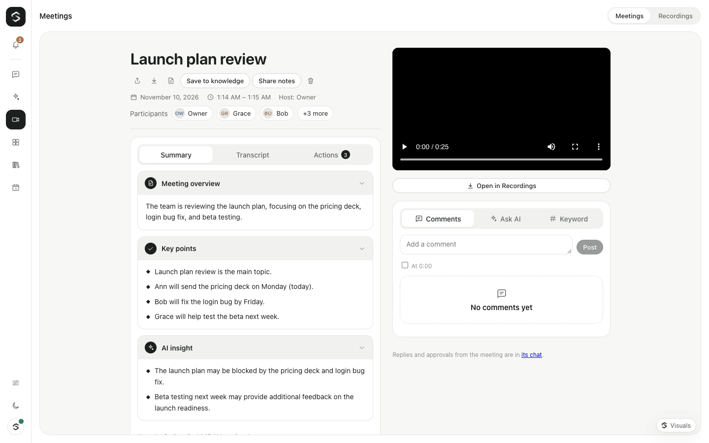

# Meetings

Meetings are calls where people and agents meet together, like a video call. Sibyl keeps the transcript, writes the notes as you talk, and finds the action items. Afterwards, the meeting has its own page with the notes, the transcript, playback and comments.

Meetings are part of the open-source edition. Audio and video recordings of a meeting are part of Agent Serve.

The room needs the realtime layer (LiveKit): see [realtime.md](realtime.md) to turn it on. Without it you can still schedule meetings and read the notes of past ones.

## Start a meeting

- **Meetings** in the rail → **New meeting**: start now, or schedule one. When your Google or Microsoft calendar is connected ([integrations.md](integrations.md)), you can pick one of your next events to fill in the title and time.
- **Meet** at the top of a chat starts a meeting from that chat. Replies, visuals and approvals from the meeting land in that chat.
- Choose how Sibyl joins: as a **participant** (she answers when someone says “Sibyl”) or as a **silent note-taker**.

Before you join, the pre-join screen shows your camera and a microphone level, and lets you pick devices.

## In the room

- The person talking is shown large; everyone else is in the strip below. A shared screen takes the large tile. Click a tile to pin it.
- Each person and agent has a name pill with their speaker colour. Agents show their animated avatar and a ring while they speak.
- Controls: microphone, camera, present your screen, captions, raise your hand, people, AI notes, add an agent, invite, leave.
- On a phone: one large tile, the others in a strip you can swipe.

### Agents

The host adds agents (**Add an agent**) and picks a role for each:

| Role | What it does |
|---|---|
| **Participant** | Listens, and speaks when someone says its name (“Nova, …”, “@Nova”), when the host hands it the floor, or when the same person follows up within 8 seconds. See [realtime.md](realtime.md#calls). |
| **Silent note-taker** | Never speaks: it has no audio track at all. It is shown with a “Taking notes” badge, and the notes are written in its name, following its instructions (for example “capture budget, decision makers and next steps”). |

The host can switch an agent's role, or Sibyl's, during the meeting (People → the role menu). Sibyl always stays in the room: she keeps the transcript.

### AI notes

Open **AI notes** in the room, or the meeting's page:

- **Summary**: an overview, key points and AI insights (risks, open questions). They refresh every few minutes from what was said since the last refresh only, and once more when the meeting ends.
- **Transcript**: every line with who said it and when. Search it; on the meeting page, click a time to jump there.
- **Actions**: action items with the owner and due date when someone said them. **Create task** makes a one-time task (a routine that runs once, at 09:00 on the due date) after you approve it, like any other action Sibyl takes.
- **Ask AI**: ask about the meeting (“What did we decide about pricing?”). Answers come from the transcript and mention when things were said.
- **Keyword**: the words said most. Pick one to find it in the transcript.

### Guests

**Invite → Copy guest link** gives a link (`/join/<id>?k=…`) for people without an account. They check their camera and microphone, give their name and ask to join. The host sees them under **People → Asking to join** and admits or denies them. A guest gets a room token only after the host admits them.

Guests see the room and its captions. They never see the notes, transcript or comments, unless the host shares the notes by link (below).

People waiting in the lobby, and raised hands, are kept with the meeting: a gateway restart or a reload doesn't lose them. Someone who joins later sees the hands already up.

People in the workspace join with **Invite → Copy link for the workspace** (`/call/<id>`).

### Host controls

The host can mute someone's microphone (they can unmute themselves), remove someone, and **End meeting for everyone**.

If the host leaves (or closes the tab) while another member of the workspace is in the room, the meeting goes on: that member becomes the host, and their own session brings Sibyl back (replies and approvals then land in their chat). Everyone sees who hosts now. Only **End meeting for everyone** ends it, or the room emptying. Guests never become hosts.

## After the meeting

When the meeting ends, the final notes are written and everyone who was there gets a **Notes ready** notification.

The meeting's page (`/meetings/<id>`) has:

- the title (the host can rename it), date and time, and participant chips;
- Summary, Transcript and Actions;
- the people in the meeting and **playback**: a timeline coloured by who spoke, a waveform, the time, speed, skip and play. With Agent Serve and a recording, it plays the audio with its waveform, or the video. Clicking a line of the transcript jumps there. Without one, the same controls walk through the transcript.
- **Comments** with reactions and replies, **Ask AI** and **Keyword**;
- **Export** as Markdown, **Print** (or save as PDF), and **Save to knowledge** (the notes and transcript become a document agents can search).
- **Share notes** (host): a read-only link to the summary and action items, optionally with the transcript, for people without an account. It works for 1, 7 or 30 days, shows how often it was opened, and can be revoked. Only a hash of the link's token is stored.

## Recordings (Enterprise)

With a licence that includes `recordings`, people with `calls.record` see **Record audio** and **Record video** under Invite in the room. Everyone in the room sees **Recording** while it runs. The recording is linked to the meeting and plays on its page. All recordings are under **Meetings → Recordings**, with search, filters, how long each is kept, legal hold, play, download and delete. See [realtime.md](realtime.md#recordings-enterprise).

## Share notes

On a meeting's page the host picks **Share notes**, chooses how long the link works and whether the transcript is included, and copies the link (`/shared/meetings/<id>?t=…`; hosted links also carry `&o=<organization>`). Whoever opens it sees the title, date, people, summary, key points, insights and action items, and the transcript if shared. They can't comment, ask or see recordings. The host sees the open links with how often each was opened, and revokes them.

## Cost

Notes use a cheap model: `SIBYL_MEETING_MODEL`, else the catalogue's cheapest preset, else the voice model. Each refresh sends only the new part of the transcript plus the notes so far, so a long meeting costs about the same per refresh as a short one. Ask AI uses the deep brain's model. All of it is metered as **Meeting notes** (`meetings`) and checked against your budgets before each call.

Transcription is metered as speech-to-text (`stt`) on the host's session.

Measured on 2026-11-09 (see “Verified” below):

| What | Measured |
|---|---|
| One notes refresh (z-ai/glm-5.3-flash, ~600 tokens in, ~350 out) | $0.0001–0.0003 |
| Transcription, whisper-large-v3-turbo | $0.0000033 per second of speech |
| Transcription, gpt-4o-mini-transcribe | $0.00003 per second of speech |
| Ask AI (claude-sonnet-5.5) | $0.003 per question |

For a one-hour meeting with a silent note-taker (20 refreshes with ~3 minutes of new talk each, ~1,300 tokens in and ~400 out, plus the final pass): about **$0.01 for the notes**, and **$0.01–0.11 for transcription** depending on the speech-to-text model: **$0.02–0.12 per meeting-hour** in all.

## Settings

| Variable | Default | What it does |
|---|---|---|
| `SIBYL_MEETING_MODEL` | cheapest preset | Model for meeting notes |
| `SIBYL_MEETING_NOTES_INTERVAL_SECONDS` | `180` | How often notes refresh while a meeting runs (at least 10) |

## Permissions

Meetings use the existing permissions:

| Who | Can |
|---|---|
| Anyone in the workspace with `chat.use` | See meetings, their notes, transcripts and comments; join; comment; Ask AI |
| The host (who created it) | Rename, admit guests, mute, remove, change agent roles, end for everyone, delete |
| Workspace admins | Also rename and delete |
| `agents.use` | Needed to add agents |
| `calls.record` (Enterprise) | Record and play recordings |
| Guests | Only their own room, after the host admits them |

## API

| Request | Who |
|---|---|
| `GET /api/meetings?q=` · `POST /api/meetings` | `chat.use` |
| `GET` · `PATCH` · `DELETE /api/meetings/<id>` | `chat.use`; changes: host or admin |
| `GET /api/meetings/<id>/transcript` · `/export` | `chat.use` |
| `POST /api/meetings/<id>/notes` (refresh) · `/ask {question}` | `chat.use` |
| `POST /api/meetings/<id>/end` | host |
| `PUT` · `DELETE /api/meetings/<id>/agents/<agentId> {role}` | host (+ `agents.use`) |
| `POST /api/meetings/<id>/participants/<identity>/mute` · `/remove` | host |
| `GET /api/meetings/<id>/lobby` · `POST /api/meetings/<id>/lobby/<ticket> {admit}` | host |
| `GET` · `POST /api/meetings/<id>/shares {days, transcript}` · `DELETE …/shares/<shareId>` | host (or a workspace admin) |
| `POST /api/meetings/<id>/shared {token}` | anyone with the link |
| `GET` · `POST /api/meetings/<id>/comments`, `PATCH` · `DELETE …/comments/<cid>`, `POST …/comments/<cid>/reactions {emoji}` | `chat.use` (edit: author) |
| `GET /api/meetings/calendar` | `chat.use` + `integrations.use` |
| `POST /api/meetings/<id>/preview {key}` · `POST /api/meetings/<id>/lobby {key, name}` · `GET /api/meetings/<id>/lobby/<ticket>` | guests (the link's key or their ticket) |
| WS `meeting.task {meetingId, actionId}` → `meeting.task_result` | the session's approval card |

In the room, the gateway nudges browsers over LiveKit data (topic `sibyl.meeting`: `notes`, `lobby`, `roles`, `ended`, `recording` with `state`, `hands` with the hands kept by the meeting, `host` with the new host's identity); they then fetch over HTTP, where access is checked. Raised hands travel on `sibyl.hand`; Sibyl's room agent keeps them on the meeting.

## Verified

Run live on 2026-11-09 with the LiveKit dev server, the gateway and scripted participants (`@livekit/rtc-node`) speaking synthesized audio:

- A silent note-taker agent joined with no audio track; Sibyl as note-taker did not answer when named; both kept the transcript and the notes.
- A participant agent answered in the room when named. Switching Sibyl to participant during the meeting made her answer when named.
- A guest with a wrong key was refused; a guest waited in the lobby without a token, the host was nudged, admitted them, and the guest's words appeared in the transcript as a guest.
- Notes refreshed during the meeting; **End meeting for everyone** disconnected everyone and wrote the final notes, credited to the note-taker agent, with three action items (owners and due dates); Ask AI answered from the transcript; comments, a reply and a reaction; Markdown export.
- The room and the meeting page in headless Chromium with a fake camera: light and dark, desktop and 375 px.

Run live again on 2026-11-10 with LiveKit, Redis, egress and SIP in Docker, the gateway (with the Enterprise dev licence) and the web app, two headless Chromium browsers with a fake camera and a spoken WAV as microphone (host and guest), and a scripted member (Bob):

- The host started a meeting from **Meetings → New meeting → Start now**; the guest asked to join from the guest link and the host admitted them under People; both cameras were in the room; the host presented their screen.
- A silent note-taker (added from **Add an agent**) joined with no audio track; a participant agent answered Bob in the room when he named it ("The capital of France is Paris.").
- The guest raised a hand: the host saw it and it was stored on the meeting. The host muted the guest (LiveKit reported the track muted) and removed Bob.
- **Record video** made everyone, the guest included, see **Recording**; the MP4 (1280×720, speaker layout with the shared screen) was linked to the meeting and played on its page. **End meeting for everyone** ended the guest's call; the final notes were credited to the note-taker with three action items.
- A guest's knock and a raised hand survived a gateway restart; after the restart the host's session brought Sibyl back and she sent the kept hands to the room. The host leaving with Bob still there made Bob the host (everyone got the `host` signal) and the meeting stayed live.
- Hosted mode with two organizations: a guest link and a shared-notes link reach the right organization (also for a guest signed in to the other one); the other organization's id finds nothing.
- Without a licence: no Recordings tab, `/api/recordings` is 404, and the meeting page says recordings come with Agent Serve.

Not verified live: the new host's browser bringing Sibyl back after a handover (tested with the host's WebSocket session and a scripted member, not two signed-in browsers), calendar import against a real Google or Microsoft account.
