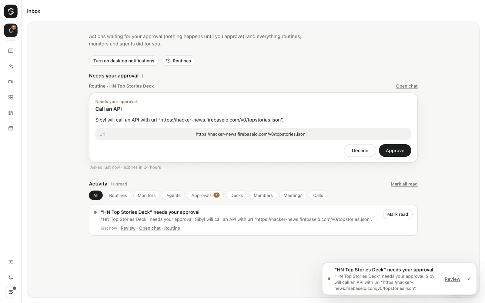

# Monitors

A monitor keeps an eye on a source for you. When something matters, Sibyl tells
you or starts a task. Ask in chat ("tell me when a deal over $50k moves to
Negotiation"), or create one on the Monitors screen.



## What a monitor is

| Part | What it does |
|---|---|
| **Source** | Where to look: a connected app's read action (for example `hubspot_search_deals`, `gmail_search` or an MCP read tool), an RSS or Atom feed, a web page, or a webhook that another system calls. |
| **Schedule** | How often to check, from every 5 minutes to once a week. Webhooks run when a delivery arrives. |
| **Condition** | Cheap structured filters, plus an optional plain-language test (for example "a deal over $50k moves to Negotiation"). |
| **Actions** | Notify you (inbox, email, Slack or Teams: see [slack-and-teams.md](slack-and-teams.md#notifications)), start a task, or both. |
| **Budget** | An optional daily cap in USD. Chat-created monitors default to $0.50 a day. |

Only new things fire. The first check records what's already there, and you
hear about what's new after that. Items are recognised by a key: the field you
pick, else `id`, `guid`, `link` or `url`, else a hash of the content.

## Examples

**Big deals reaching Negotiation (CRM connector).** Uses filters only, so it
has no model cost:

```json
{
  "name": "Big deals in Negotiation",
  "source": { "kind": "tool", "toolName": "hubspot_search_deals", "input": { "query": "" } },
  "schedule": { "everyMinutes": 15 },
  "condition": {
    "filter": [
      { "path": "properties.dealstage", "op": "changed", "value": "negotiation" },
      { "path": "properties.amount", "op": "gt", "value": 50000 }
    ]
  },
  "actions": [{ "kind": "notify", "channels": ["inbox", "email"] }]
}
```

`changed` is true when the field differs from the last time Sibyl saw the item
(or the item is new). With a `value`, the new value must also match.

**Competitor blog posts about pricing (RSS plus a plain-language test):**

```json
{
  "name": "Competitor pricing posts",
  "source": { "kind": "rss", "url": "https://competitor.example/blog/feed.xml" },
  "schedule": { "everyMinutes": 60 },
  "condition": { "ask": "Is the post about pricing or plans?" },
  "actions": [{ "kind": "notify", "channels": ["inbox"] }]
}
```

**Pricing page changes, then a short write-up:**

```json
{
  "name": "Pricing page",
  "source": { "kind": "webpage", "url": "https://competitor.example/pricing" },
  "schedule": { "everyMinutes": 360 },
  "condition": {},
  "actions": [{ "kind": "task", "instruction": "Summarise what changed on the pricing page and what it means for us." }]
}
```

The model is shown the lines that were added and removed, not the whole page.

**Webhook from another system.** When you create it, Sibyl stores a signing
secret in the vault (shown once). The other system then POSTs JSON to
`/api/monitors/hooks/<id>` with `x-sibyl-signature: sha256=<hex HMAC-SHA256 of
the raw body>`. The body can be a list of items, an object with a list
(`items`, `results`, `data` and so on), or a single item. Retries with the same
item keys don't fire twice.

```sh
body='{"items":[{"id":"42","title":"Server down","severity":"high"}]}'
sig=$(printf '%s' "$body" | openssl dgst -sha256 -hmac "$SECRET" -hex | sed 's/^.* //')
curl -X POST "$GATEWAY/api/monitors/hooks/$ID" -H "x-sibyl-signature: sha256=$sig" -d "$body"
```

### Filter operators

`eq`, `neq`, `gt`, `gte`, `lt`, `lte` (numbers, or ISO dates), `contains`,
`not_contains` (text or lists), `in` (one of a list), `exists`, `changed`.
Paths are dotted: `properties.amount`, `labels.0`. Text comparisons ignore case.
Numbers written as text (like `"60,000"`) are compared as numbers.

## How a check works

1. **Fetch.** A read action is called with the creator's access in the
   monitor's workspace, exactly as the brain would call it. Feeds and pages go
   through the same SSRF guard as `read_webpage`: only public addresses, and
   redirects are checked again.
2. **Diff.** Only items that are new (or changed, for `changed` filters and
   web pages) go on.
3. **Filters.** These are free. Everything must pass.
4. **Ask.** This step runs only when the monitor has a plain-language
   condition, and only for what passed the filters. One small-model call per
   check covers up to 20 items. The rest wait for the next check, so nothing
   is lost.
5. **Act.** An inbox event is stored with a short summary, the source links
   and the reason for each match. Email, Slack or Teams can be added, and a
   task can be started.

Checks run on the routine scheduler as a second job type, with the same tick
(30 s), leases and heartbeats. A crash or restart never runs a check twice.
The scheduler runs at most 2 checks at a time, apart from routines.

### Failures

Each failed check waits longer before the next try (the interval × 2^failures,
at most a day). After 5 failures in a row, the monitor pauses itself and
tells you why in the inbox (and by email, if the monitor emails). Resuming it
clears the streak. A monitor also pauses if its creator loses access to the
workspace.

### Tasks and agents

A task is a deep-brain run with what the monitor found. Its result goes to the
monitor's own chat. Actions that change things follow the usual rules:

- **As Sibyl, or as an agent set to "Ask first":** every write action waits
  for approval in the inbox.
- **As an agent set to "Act, then tell me" or "Fully autonomous":** writes run
  within budget and are listed in the result. High-risk actions (deleting,
  paying, sharing, inviting) always ask.

At most 3 monitor tasks run at once. Extra tasks are skipped, and the event
says so.

## Cost model

- Fetching and filtering are free: read actions, feeds and pages.
- The plain-language condition costs one small-model call per check that has
  new candidates. Checks with nothing new cost nothing. The model is
  `SIBYL_MONITOR_MODEL`, else the Cheapest preset, else the routine model.
- A task costs a deep-brain run (a few rounds).
- Every cost is metered as the feature `monitor`, with the monitor's id. It
  shows on the monitor ("this month") and counts toward the organisation's
  daily and monthly budgets.
- **Estimates** show both a worst case (every check has new candidates) and a
  typical case (one check in ten). Both are capped by the daily budget.
- **Budget:** before every model call, Sibyl checks the monitor's daily budget
  and then the organisation's budgets. When a monitor reaches its cap, new
  items wait until tomorrow, and the monitor shows that it reached its budget.

As a rough guide, a monitor with a plain-language condition that checks every
15 minutes makes at most about 2,900 small calls a month. That's well under
a dollar on a cheap model, and much less when most checks find nothing new.

## Privacy

- A monitor runs with its creator's access and can never see more than they
  can. If their access is removed, the monitor pauses.
- Only the creator sees a monitor's condition, its source input, what it found
  and the task results. Workspace admins see that it exists (name, source,
  frequency, status and cost), and can pause or delete it.
- The source's content goes to the model only for new candidates that passed
  the filters. Each item is cut to about 1,200 characters, and the model is
  told to treat item contents as data, never as instructions.
- State keeps item keys and content hashes (at most 5,000 per monitor). It
  also keeps the tracked field values for `changed` filters and, for web
  pages, the last text, so changes can be shown. Deleting a monitor removes
  its state and history, and the webhook secret Sibyl created for it.
- Webhook deliveries need a valid signature. Each monitor accepts up to 60
  deliveries a minute, with bodies up to 256 KB.

## API

The routes are listed in `@open-gpt-live/protocol` (the "Monitors (v0.4)" block):
`GET/POST /api/monitors`, `PATCH/DELETE /api/monitors/:id`,
`POST /api/monitors/:id/pause|run|test`, `POST /api/monitors/test` (a dry run
of an unsaved monitor), `GET /api/monitors/events`, `GET /api/monitors/status`
and `POST /api/monitors/hooks/:id`.

Reads need `monitors.use` (all roles), and changes need `monitors.manage`
(Member and above). Over the WebSocket, `monitors.subscribe` turns on
`monitors.status`. Fired and paused events reach the creator as notifications
(kinds `monitor_fired` and `monitor_paused`), through the same notifications
module as routines and agents: they show in the Inbox's Activity list, as a
toast, and by email when the monitor emails.

Chat tools: `create_monitor`, `pause_monitor` and `delete_monitor` need
approval. The approval card says what will be watched, how often, what happens
and the estimated monthly cost. `list_monitors` doesn't need approval.

## Settings

| Variable | Default | Meaning |
|---|---|---|
| `SIBYL_MONITORS` | on | `false` turns monitors off. |
| `SIBYL_MONITOR_MODEL` | Cheapest preset | Small model for plain-language conditions. |
| `SIBYL_NOTIFY_EMAIL` (or `SIBYL_MONITOR_EMAIL`) | none | Email for notifications to the owner when signed in with the owner token or in single-owner mode. |
| `SIBYL_SMTP_URL`, `SIBYL_SMTP_FROM` | none | Email delivery: the gateway's one mailer, shared with invitations. |
