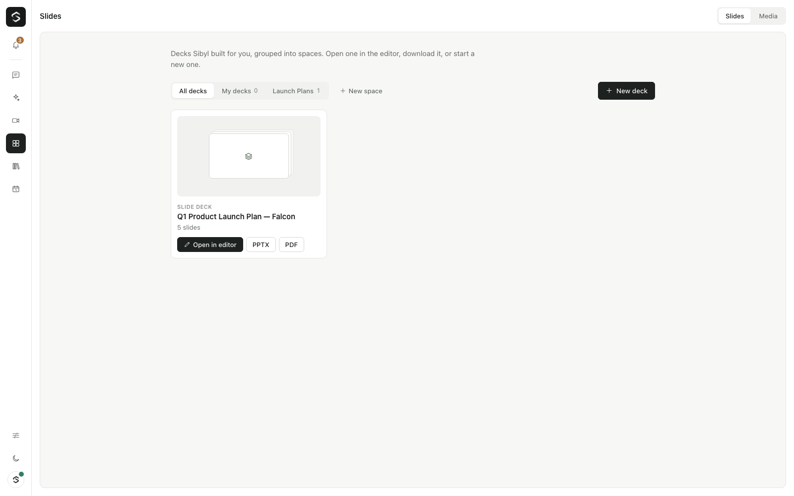
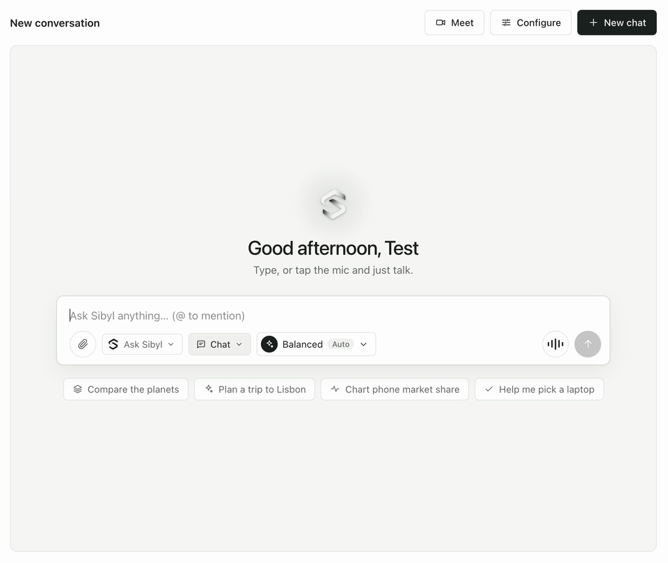

# Sibyl Slides

Sibyl Slides builds slide decks from a prompt, an outline or real data, and lets you edit them in a browser editor. Decks export to PowerPoint (PPTX) and PDF.





You can make a deck two ways:

- **In chat.** Ask Sibyl for a deck ("make a 6-slide deck on our Q3 pipeline"). Sibyl gathers the facts with its other tools first (web search, your connections), then calls `create_slides`. You approve the build on a card that says what will happen and roughly what it costs, for example *Create an 8-slide deck 'Q3 market overview' (≈$0.03)*. The finished deck shows as a card with **Open in editor**, **PPTX** and **PDF**.
- **In the library** (`/library/slides`). Click **New deck**, describe the deck, optionally pick where the data comes from, choose a template and a slide count, and click **Build deck**. When the deck is ready the editor opens on its own.

Slides is a separate service (`apps/slides`) that the Sibyl gateway and web app talk to. It is derived from [Presenton](https://github.com/presenton/presenton); see [Licence](#licence).

## How it fits together

| Part | Where | What it does |
|---|---|---|
| Deck engine | `apps/slides/servers/fastapi`, port 8000 | Writes the outline and the slides with a model on OpenRouter, renders exports (PPTX, PDF, thumbnails) with a headless Chromium. |
| Slide editor | `apps/slides/servers/nextjs`, port 3100, base path `/slides` | The editor and the export renderer. Browsers reach it through the web app at `/slides/*`. |
| Gateway | `apps/gateway/src/slides` | Brain tools (`create_slides`, `revise_slides`, `list_slides`), the library API under `/api/slides/*`, budgets and usage records, deck versions and spaces. |
| Web app | `apps/web/app/library/slides` | The deck library, the New deck panel and the deck cards in chat. |

The browser never talks to the engine directly: library calls go to the gateway, the editor goes through the web app's `/slides` proxy, and downloads and thumbnails are streamed by the gateway. The engine API is documented in [`apps/slides/API.md`](../apps/slides/API.md).

## Running it

### Development

```bash
corepack pnpm slides:setup   # once: Python env (uv), editor deps, export runtime
corepack pnpm slides:dev     # engine on :8000, editor on :3100
corepack pnpm dev            # gateway on :8787 and web app on :3000 (another terminal)
```

`slides:setup` needs [uv](https://docs.astral.sh/uv/) and Node 22. The engine reads `OPENROUTER_API_KEY` from the repo-root `.env`. Open <http://localhost:3000/library/slides>.

The gateway finds the engine at `http://localhost:8000` on its own when it is running at gateway start. If you start Slides later, restart the gateway or set `SIBYL_SLIDES_URL=http://localhost:8000` so it registers the slides tools anyway.

To build the editor for production: `corepack pnpm slides:build`, then `corepack pnpm slides:start`.

### Docker

`docker compose up --build` starts a `slides` service built from `Dockerfile.slides` (engine and editor in one container, with Chromium for exports). It is not published on the host: the gateway reaches it at `http://slides:8000` and the web app proxies `/slides/*` to `http://slides:3100`. Decks, exports and thumbnails live in the `slides-data` volume (`/app_data`). See [deployment.md](deployment.md#sibyl-slides).

## Configuration

Engine (the `slides` service, or `apps/slides/start.mjs`):

| Variable | Default | Purpose |
|---|---|---|
| `OPENROUTER_API_KEY` | — | The only key needed. Never written to the engine's database. |
| `SIBYL_SLIDES_MODEL` | `deepseek/deepseek-v4.1-flash` | Model that writes the decks. It must support JSON-schema output. Alternatives: `google/gemini-2.5-flash-lite`, `qwen/qwen3.8-flash`, `openai/gpt-5-mini`. |
| `SIBYL_SLIDES_IMAGE_PROVIDER` | empty (no image generation) | `pexels` or `pixabay` (free stock photos, needs `PEXELS_API_KEY` / `PIXABAY_API_KEY`), or an image model (`gpt-image-2`, `gemini_flash`, `comfyui`, …). Without one, image slots keep a neutral placeholder; icons always work. |
| `SIBYL_OWNER_TOKEN` | empty | Same token as the gateway. When set, every engine call needs it. |
| `SIBYL_APP_URL` | `http://localhost:3000` | The Sibyl app, for the editor's links back when it is opened on its own port. |
| `APP_DATA_DIRECTORY` | `apps/slides/data` (dev), `/app_data` (Docker) | Database, exports, uploads, thumbnails. |
| `SIBYL_SLIDES_API_PORT` / `SIBYL_SLIDES_WEB_PORT` | `8000` / `3100` | Engine and editor ports. |
| `SIBYL_SLIDES_HOST` | `127.0.0.1` (dev), `0.0.0.0` (Docker) | Bind address. Keep the engine private. |

Gateway and web app: `SIBYL_SLIDES_URL`, `SIBYL_SLIDES`, `SIBYL_SLIDES_MODEL`, `SIBYL_SLIDES_USD_PER_SLIDE`, `SIBYL_SLIDES_TIMEOUT_MS`, `SIBYL_SLIDES_EDITOR_BASE` and `SIBYL_SLIDES_WEB_URL`, described in [configuration.md](configuration.md#sibyl-slides).

## Templates

Four Sibyl template families ship with the engine. All use Inter.

| Template | Look |
|---|---|
| `sibyl-graphite` (default) | Calm and light: graphite ink, sage accent. Most decks. |
| `sibyl-night` | Dark canvas, light text. Keynotes and screens. |
| `sibyl-editorial` | Large headlines, generous whitespace. Narratives and pitches. |
| `sibyl-data` | Compact type, KPI strips, large charts. Reports and reviews. |

A **space** (left column of the library) can set a default template and instructions that apply to every deck in it ("for the board, formal tone, at most 10 slides").

Decks, spaces and running builds belong to the **workspace** they were made in, and the library only shows the current workspace's. `/api/slides/*` sits behind the same sign-in and permission check as the rest of the gateway: `slides.use` to browse and download (viewers and up), `slides.manage` to generate decks and change spaces (members and up).

## Data sources

**Get data from** in the New deck panel lists only sources that read:

- **Web:** web search, read a webpage, Wikipedia, weather, currency rates, world time.
- **Your connections:** read-only tools from your MCP servers, knowledge bases and integrations, one entry per server.

Memory, secrets, routines, slides, file and calculator tools are never offered, and tools that change something (`effect: "write"`) are never offered even from a connection. The filter is on the gateway (`GET /api/slides/sources`), and the research step only gets the tools that passed it. With sources picked, Sibyl first gathers the facts (up to five rounds of tool calls), writes a slide-by-slide outline with the figures and their sources, then builds the deck from that outline.

## Building, editing and versions

- A build keeps running if you close the New deck panel or leave the page. When you come back to the library, a **Deck ready · Open** notice takes you to it. **Stop** cancels the build.
- The editor (`/slides/presentation?id=…`) edits text, layouts, charts, tables, icons and images in place and saves as you go. Its rail is the app's rail, and **Slides** (top left) returns to the library, to the space the deck came from.
- The library shows each deck's first slide as its thumbnail. The engine renders it once with the export renderer and caches it in `APP_DATA_DIRECTORY/thumbnails`; after you edit slide 1, a fresh one appears within a few minutes.
- **Revise** (or asking in chat) makes a new version and keeps the old one. The library card lets you switch between versions.

The editor's font menu offers a curated set: Inter, DM Sans, Lato, Montserrat, Open Sans, Poppins, Roboto, Lora, Playfair Display, Source Serif 4, JetBrains Mono and Caveat. A deck that names a font outside this set (for example one imported from elsewhere) is shown in Inter.

## Exports

**PPTX** and **PDF** on a deck card download through the gateway. The first PPTX is made while the deck is built; a PDF (or a PPTX after edits) is exported on demand, which takes a few seconds while Chromium renders the deck. Exports are editable PowerPoint shapes and text, not pictures.

## Costs

A deck costs an outline call, a structure call and about one model call per slide on the engine's model (`SIBYL_SLIDES_MODEL`). The engine asks OpenRouter for usage accounting on every call and adds up the real dollar cost of each build, retries included; the gateway records that **actual** cost on the Usage tab (under "slides") and against your daily and monthly budgets. The engine stores it on the deck too (`cost_usd`). With the default `deepseek/deepseek-v4.1-flash`, a 5-slide deck cost $0.02 in testing.

Before a build, the gateway checks your budget with an **estimate** and shows it on the approval card in chat (for example *≈$0.05*). The estimate uses the model and per-token price the engine reports (`GET /api/v1/sibyl/config`, so the gateway and the engine never disagree about the model), and once decks have been built, the actual average cost per slide. Only when the engine reports no cost (another provider, or an older engine) is the estimate recorded instead, marked as estimated. Image generation (`SIBYL_SLIDES_IMAGE_PROVIDER`) is billed by that provider and not included. Research with data sources adds the deep brain's tool calls, metered as usual.

## Turning it off

Set `SIBYL_SLIDES=false` on the gateway: the slides tools disappear from chat and the library says Slides is not running. Not running the `slides` service has the same effect.

## Licence

Sibyl Slides is derived from [Presenton](https://github.com/presenton/presenton) (`v0.9.12-beta`), © Presenton contributors, licensed under the **Apache License 2.0**. `apps/slides/LICENSE` is Presenton's licence and `apps/slides/NOTICE` keeps its notices and third-party attributions. Sibyl's changes (rebranding, removal of telemetry and hosted-service features, owner-token auth, the `/slides` base path, Sibyl templates, thumbnails, the curated font set) are listed in [`apps/slides/UPSTREAM.md`](../apps/slides/UPSTREAM.md), which also explains how to pull in upstream updates. Bundled fonts are under the SIL Open Font License (`OFL.txt` next to each font).
