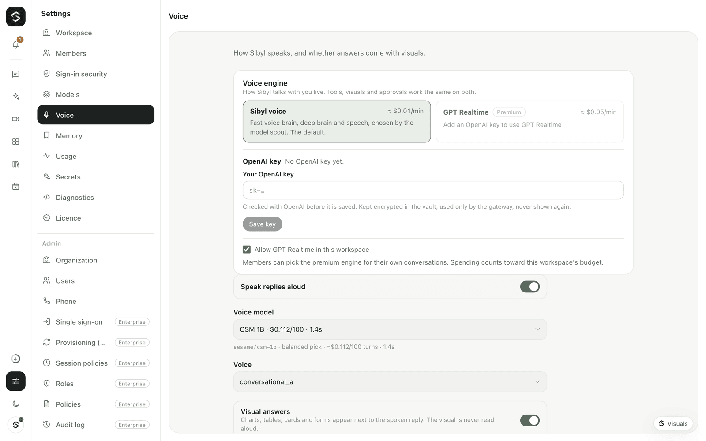

# Voice

Sibyl's live conversation is built from swappable OpenRouter models, not a single vendor's realtime API. This page explains how a spoken turn flows, how Sibyl decides when you have finished, how it stays fast, and what the measured latency looks like (with the same metric names as LiveKit's).



For people who want the most natural voice and are happy to pay more, OpenAI's GPT Realtime is available as a premium [voice engine](#voice-engines-sibyl-voice-and-gpt-realtime). Sibyl voice stays the default.

## WebSocket or LiveKit

By default the browser streams your voice to the gateway over its WebSocket, and Sibyl's voice comes back the same way. Nothing else is needed.

When the gateway has [LiveKit](realtime.md) configured (`LIVEKIT_URL`, `LIVEKIT_API_KEY`, `LIVEKIT_API_SECRET`), hands-free voice runs over WebRTC instead: the microphone and Sibyl's voice travel through a LiveKit room, and the gateway's room agent detects your turns with the same speech detector. The brain, the turn rules, barge-in, hedging and budgets below are the same in both. Transcripts, replies, visuals and approvals stay on the WebSocket. If the room can't be joined, voice falls back to the WebSocket. LiveKit also brings calls with several people and agents, phone calls and streams; see [realtime.md](realtime.md).

## Three ways to talk

Voice and typing share one conversation. Switch between them whenever you like; both brains see everything said, typed and shown so far.

| Mode | How | What happens |
|---|---|---|
| **Hands-free** | Tap the mic button | The mic stays on (echo-cancelled). The browser detects when you start and stop speaking and sends each turn as it ends. Tap again to end. |
| **Push-to-talk** | Hold the mic button | The clip is recorded while you hold and sent when you let go. With a voice brain active, the browser converts the clip to WAV so the voice brain hears your tone too. |
| **Typing** | The composer | A normal chat reply from the deep brain: text and visuals, with tools when needed. Nothing is spoken and there are no emotion cues. Messages sent while Sibyl is answering are queued. |

## The live pipeline

```text
mic (always on, echo-cancelled) ──► end of turn (0.4 s of silence) ──► raw audio
        │                                                                 │
        └─ instant on-device captions (display only)                      ▼
                                         VOICE BRAIN (audio-native model)
                                         hears tone, emotion and hesitation and replies
                                         like a person: "[sympathetically] Oh no, that's…"
                                                │                          │
                         speech + emotion cues ─┘                          └─ "@brain <task>"
                                │                                                  │
          expressive speech, streamed and played as it arrives       DEEP BRAIN (stronger model)
          and gaplessly; talking over it stops it                    reasons with the whole conversation,
                                                                     streams a visual, then a short
          background transcription ──► accurate transcript           spoken gist when you're free
```

### The voice brain

Your audio goes straight to an audio-native model, so it reacts to how you said something, not only the words. Its prompt asks it to:

- react first, then answer, usually in one or two sentences;
- mirror your mood: slow down and reassure when you sound stressed, share excitement when you're excited;
- use at most two emotion cues per reply, such as `[warmly]`, `[laughs]`, `[softly]`;
- ask you to repeat when the audio was unclear rather than guess.

If the audio has no speech meant for Sibyl — background noise, a cough, someone else talking, a TV — the voice brain answers `@silence` and the turn is dropped quietly (`llm.done` with reason `ignored`).

**Emotion cues** are performed by voices that support them (models marked `emotionTags: true`, such as ElevenLabs v3). For every other voice they are removed before speech, so you never hear "bracket laughs".

### The deep brain

When a request needs careful thinking, accuracy, several steps or something on screen, the voice says a short line like "let me pull that up" and ends its reply with:

```text
@brain <a precise, self-contained task with every relevant detail>
```

The gateway then starts the deep brain with the full conversation. The deep brain can call tools (web search, weather, your MCP servers and so on; see [tools.md](tools.md)) and pauses for your approval before anything that changes something.

- **It works from your real words.** The deep brain waits up to 3 seconds for the accurate transcript before starting.
- **Kept promises.** If the voice says it will look into something but forgets the `@brain` line, the gateway hands the request off anyway.
- **Early gist.** The deep brain writes its short spoken summary first. It is spoken as soon as it is written, while the visual keeps streaming in.
- **No stale interruptions.** If you have already moved on to something else, the old gist is not spoken. The visual stays on screen and in the conversation.
- **Shared context.** The deep brain's result is added to the history, so both brains can build on what was shown ("the last day sounds exhausting, I'm going with my grandma" works as a follow-up).

### Transcripts

While you speak, the browser shows an instant caption from its own speech recognition (where available). This is only a display hint: the voice brain hears the real audio. After the turn, a transcription model writes an accurate transcript in the background, and the gateway replaces the caption with it (`transcript.update`).

## Turn-taking

### Ending a turn

The browser's voice activity detector ends a turn after 0.4 seconds of silence (`NEXT_PUBLIC_VAD_HANGOVER_MS`). That is quick on purpose, because turn merging handles people who pause mid-thought. After 0.2 seconds of silence it already reports a pause, so the reply can start early ([preemptive generation](#preemptive-generation)). Other safeguards:

- a turn starts only after 160 ms of sound, and turns with less than 200 ms of voiced audio are discarded;
- 400 ms of audio from just before speech was detected is kept, so the first syllable isn't lost;
- the detector calibrates to the room for one second and follows slow changes in background noise;
- while Sibyl is speaking, the speech threshold is raised 2.5× and new speech is ignored for 300 ms after playback ends, to avoid reacting to its own voice.

All of these are adjustable; see [configuration.md](configuration.md#voice-activity-detection).

### Turn merging

If you start speaking again within 3 seconds and before Sibyl has started answering out loud, the earlier fragment and its pending reply are dropped, and your whole thought is answered once. The browser is told with `turn.merged`.

### Barge-in

Talk over Sibyl and it stops: the browser stops playback at once, and the gateway cancels the reply and any speech still being generated. A deep-brain gist that hasn't been spoken yet is dropped once your new turn starts. Measured time from you starting to talk to silence is about half a second.

## Staying fast

What you wait for after you stop talking is, in order: the speech detector deciding you have finished, the voice brain's first words, and the speech model's first audio. Sibyl works on all three.

### Preemptive generation

After 0.2 seconds of silence the speech detector reports a pause (`vad.speech_pause`), before it decides your turn is over. The gateway starts the voice brain on the audio so far. If the turn then ends without more speech, that reply is used, so the voice brain has already been working for part of the wait. If you carry on (`vad.speech_resume`), or anything the reply depends on changed (the conversation, the model), it is cancelled and the full turn is answered once.

- This is the same idea as LiveKit Agents' `preemptive_generation`, which starts the LLM on the final transcript before the end of turn is confirmed.
- A cancelled start still costs its input (the audio so far), typically a fraction of a cent. At most three starts are made per turn, and a start that is never used is cancelled after 10 seconds.
- On by default. Turn it off for one session in **Settings → Voice → Speed**, or for everyone with `SIBYL_PREEMPTIVE_GENERATION=false`.
- It works on both paths: the browser's detector and the LiveKit room agent's detector report pauses the same way.
- A turn addressed to an agent is answered once the turn is final (the agent's own prompt is only known then).

### Speech that plays as it streams

- **Small first segment.** The reply is split into speech segments; the first ends at the first clause boundary ("Oh, nice," / "Sure.") after about 14 characters, or at a word boundary after 60 characters when there is no punctuation. Later segments take whole clauses. A full stop inside a number ("3.5") or an abbreviation doesn't end a segment.
- **Streaming playback.** Each segment's audio is sent on in small pieces while the speech model is still producing it (the first piece after 120 ms of audio, then 300 ms pieces). Raw PCM and WAV are cut as they arrive; MP3 is decoded on the gateway and sent as 24 kHz WAV. Opus, AAC and FLAC are still sent whole.
- Segments are synthesized in parallel and played in order, gaplessly, in the browser or the LiveKit room.

### The model check weighs speed

The [model scout](models-and-costs.md) measures each voice brain's time to first word and each speech model's time to first audio (TTS TTFB) with short live probes. The speech probe says a sentence about the size of a reply's first segment, and a speech model is judged by the slowest of three starts. For **Balanced** and **Fastest**, these two numbers weigh more than before, and models over a time budget (Balanced: 1.6 s voice brain, 1.3 s speech; Fastest: 1.3 s and 1.0 s) rank far lower.

### Hedged requests

Latency on shared provider routes varies a lot; the same model has been measured at 1 second on one call and 14 on the next. With `HEDGE_REQUESTS=true` (the default):

- if the voice brain hasn't produced a word after 1.2 s (`HEDGE_VOICE_AFTER_MS`), the same turn also goes to the fastest voice brain from a different vendor;
- if a speech segment hasn't started after 1.5 s (`HEDGE_TTS_AFTER_MS`), a duplicate request goes out on the same voice.

Whichever answers first wins and the other is cancelled. A request that fails before producing anything fails over the same way.

### Other latency work

- **Learning from live turns.** In auto mode the gateway tracks each voice brain's real time to first word and uses whichever of the scout's top three has been fastest recently. A model you choose yourself always wins.
- **Warm connections.** Each session sends a small warm-up request to the voice brain, and provider connections are kept open for up to a minute between turns instead of Node's default four seconds.

### LiveKit Inference speech (LiveKit Cloud)

When `LIVEKIT_URL` points at a LiveKit Cloud project (`*.livekit.cloud`), **Settings → Voice → Speed** offers **LiveKit Inference** for speech and transcription instead of OpenRouter:

- Speech comes from LiveKit's hosted streaming models (default Cartesia Sonic 3, `LIVEKIT_INFERENCE_TTS`) and your transcript from Deepgram Nova-3 (`LIVEKIT_INFERENCE_STT`), reached with the LiveKit project's API key. No other provider key is needed.
- The voice brain and the deep brain stay on OpenRouter, so one OpenRouter key keeps working and remains the default.
- Settings shows the price per minute of conversation for speech and transcription, from LiveKit's published prices: about **$0.021 a minute** with the defaults (25 seconds of you at $0.0048 a minute, plus about 375 characters of reply at $50 per 1M characters). LiveKit bills your LiveKit project; Sibyl meters each call at the same prices (`livekit:<model>` in Usage), so budgets apply.
- Live turns are PCM, which LiveKit transcribes; push-to-talk clips in other formats still go to the OpenRouter transcription model.
- Choosing it needs `models.choose`, like choosing models.
- **Not verified live.** No LiveKit Cloud project was available while this was built. It follows the protocol LiveKit's own Agents SDK uses (see the research notes below) and is tested against a local stand-in (`apps/gateway/src/voice/fake-livekit-inference.ts`). Please report how it works on a real project.

## Latency metrics

Sibyl measures each spoken reply with the same names and definitions as LiveKit Agents' metrics, so the numbers can be compared with LiveKit's:

| Metric | LiveKit name | From → to |
|---|---|---|
| End-of-utterance delay | `end_of_utterance_delay` | end of speech (last voiced audio) → the turn is committed. Includes the silence the detector waited for. |
| Transcription delay | `transcription_delay` | end of speech → the final transcript. The voice brain hears the audio itself, so on Sibyl voice this runs in parallel and isn't waited for. |
| LLM TTFT | `ttft` | request to the voice brain → its first token. With preemptive generation the request starts during the pause. |
| TTS TTFB | `ttfb` | first speech request → first audio byte from the speech model. |
| Total latency | `e2e_latency` | end of speech → first audio sent to you (the WebSocket or the LiveKit room). |

LiveKit approximates total latency as end-of-utterance delay + LLM TTFT + TTS TTFB. Sibyl's total is measured directly; it also includes waiting for the first clause of text.

The gateway logs them as `latency.turn` and sends them to the browser (`turn.metrics`) on the WebSocket and the LiveKit path alike. "End of speech" is when the detector's `vad.speech_end` arrived, minus the silence it waited for (`silenceMs`).

**Settings → Diagnostics** shows the latest reply's turn metrics, the path (WebSocket or LiveKit) and whether it was started early, and next to them what your browser measured itself:

| In this browser | Measured from → to |
|---|---|
| STT first partial | start of speech → first partial transcript |
| Final transcript | end of speech → final transcript |
| LLM first token | final transcript (or sending a typed message) → first reply text |
| TTS first audio | first reply text → audio actually playing |
| Speech end → audio playing | end of speech → audio actually playing |

It also shows the voice activity detector's state, input level, noise floor and thresholds.

## Measured latency

Measured on 2026-11-10 with a scripted client: macOS `say` speech sent as live 24 kHz PCM over the WebSocket, 0.3 s of trailing silence, a `vad.speech_pause` after 0.2 s of it (as the browser's detector does), real OpenRouter, the **Balanced** preset of that day. Each condition ran 6–16 turns of short questions; numbers are medians with p90 in brackets.

| | Before | After |
|---|---|---|
| Models (Balanced) | Qwen3.8 Omni Flash, Gemini 3.8 Flash Lite TTS | Qwen3.8 Omni Flash, AssemblyAI TTS 1 |
| **End of speech → first audio sent** (`e2e_latency`) | **4.0 s** (5.0 s), 14 turns | **2.4 s** (3.0 s), 16 turns |
| Speech end signal → first audio sent | 3.7 s (4.6 s) | 2.1 s (2.7 s) |
| End-of-utterance delay | 0.3 s (the client's silence) | 0.3 s |
| LLM TTFT (voice brain) | 1.0 s (2.2 s) | 1.4 s (1.7 s), counted from the pause |
| TTS TTFB | 2.3 s (2.8 s), whole first segment | 0.4 s (0.8 s), first streamed byte |
| Same, LiveKit room: end of speech → first audio heard by the other participant | 5.0 s (6.6 s), 6 turns | 3.0 s (4.2 s), 6 turns; `e2e_latency` 2.7 s |

Where the time went: the speech model was the biggest part before (Gemini TTS sends nothing until the whole segment is made). The scout now picks a speech model that starts in about 0.4–0.8 s, and its audio plays as it streams. Preemptive generation alone saved about 0.2 s at the median and 0.45 s at p90 (with it off: 2.6 s and 3.4 s). The voice brain's first token, 1–2 seconds, is now the largest part.

In a browser add the speech detector's wait (0.4 s of silence instead of the client's 0.3 s; the pause is reported at 0.2 s either way), the network and starting playback. The **Fastest** preset picked the same models as Balanced on that day. Native speech-to-speech models (see [GPT Realtime](#voice-engines-sibyl-voice-and-gpt-realtime)) can start in under a second because one model does everything.

Earlier figures: 2.5–3.3 s on 2026-11-09 (Balanced used Kokoro then, measured in the browser) and 4.2–5.8 s on the morning of 2026-11-10 (Gemini 3.8 Flash Lite TTS).

| Other | Typical |
|---|---|
| Barge-in (you talk over it) → silence | ~0.5 s |
| Deep brain's spoken gist | ~5–8 s after handoff, with the visual streaming in alongside |

## LiveKit's realtime stack: research notes (2026-11-10)

From LiveKit's documentation and the `@livekit/agents` 1.9.5 source (Node), checked on 2026-11-10:

- **Agents framework** ([docs](https://docs.livekit.io/agents.md)): `AgentSession` runs VAD, turn detection, STT → LLM → TTS, interruptions and playout inside a LiveKit room. Sibyl doesn't use it: its room agent (`@livekit/rtc-node`) drives the same session as the browser so tools, approvals, budgets and the deep brain stay in one place (see [realtime.md](realtime.md)). Its latency ideas are reused here: metrics, preemptive generation, streaming TTS.
- **Metrics** ([data](https://docs.livekit.io/testing/observability/data.md)): `EOUMetrics` (`endOfUtteranceDelayMs`, `transcriptionDelayMs`, `onUserTurnCompletedDelayMs`), `LLMMetrics.ttftMs`, `TTSMetrics.ttfbMs`, and `e2e_latency` (user stopped speaking → agent started speaking). LiveKit publishes no typical values for them.
- **LiveKit Inference** ([overview](https://docs.livekit.io/agents/models/inference.md), [pricing](https://livekit.com/pricing/inference)): hosted STT, LLM and TTS reached with a LiveKit Cloud project's key; it needs LiveKit Cloud. Speech-to-text per minute: Deepgram Nova-3 $0.0048, AssemblyAI Universal-Streaming $0.0025, Cartesia Ink-Whisper $0.003, Deepgram Flux $0.0065. Speech per 1M characters: Cartesia Sonic 3 $50, Deepgram Aura-2 $30, Inworld TTS 2 $25, Rime Mist v3 $30. LLMs per 1M tokens, e.g. GPT-4.1 mini $0.40 in / $1.60 out, Gemini 3 Flash $0.50 / $3.00. The free Build plan includes $2.50 of credit a month and allows 5 concurrent speech-to-text and 5 text-to-speech connections ([quotas](https://docs.livekit.io/deploy/admin/quotas-and-limits.md)). The protocol (from `src/inference/{stt,tts}.ts`): WebSockets at `wss://agent-gateway.livekit.cloud/v1/{stt,tts}?model=…` with a JWT carrying the `inference` grant; `session.create`, `input_audio` / `input_transcript`, `session.finalize` / `session.flush`; `final_transcript`, `output_audio`, `done`. LLMs are OpenAI-compatible chat completions on the same gateway. Sibyl uses only speech: the voice brain needs audio input and must stay on the one OpenRouter key.
- **Turn detector** ([docs](https://docs.livekit.io/agents/logic/turns/turn-detector.md), [model](https://huggingface.co/livekit/turn-detector)): decides from what was said (text model, a distilled Qwen2.5-0.5B, 50–160 ms on CPU, 66 MB English / 396 MB multilingual) or, newer, from the audio (`v1-mini` runs locally through `@livekit/local-inference`; `v1` runs on LiveKit Cloud at $0.50 per 1,000 requests, 7,500 a month free). It lowers the wait when you sound finished and raises it (up to 3 s by default) when you don't. The text model is deprecated in favour of the audio one.
- **Preemptive generation** ([tuning](https://docs.livekit.io/agents/logic/turns/tuning.md)): on by default in Agents; starts the reply on each final transcript and reuses it if the committed turn is the same. LiveKit warns it may not always lower latency; Sibyl's measurement above shows it does here, because the voice brain hears the audio and needs no transcript first.
- **Endpointing and interruptions**: defaults 0.5 s minimum and 3 s maximum endpointing delay (0.3 / 2.5 s with the audio turn detector). Adaptive interruption handling (telling backchannels like "mm-hm" from real interruptions) runs only on LiveKit Cloud inference ($1.20 per 1,000 requests, 40,000 a month free) ([docs](https://docs.livekit.io/agents/logic/turns/adaptive-interruption-handling.md)).
- **Noise cancellation** ([docs](https://docs.livekit.io/transport/media/noise-cancellation.md)): Krisp noise and background-voice cancellation (`@livekit/noise-cancellation-node`, works with `rtc-node`) requires LiveKit Cloud and is under LiveKit's terms of service, not open source. Sibyl doesn't include it; browsers keep their own echo cancellation and noise suppression.

### The turn detector's licence, and why Sibyl doesn't use it yet

The turn-detector weights (text model and `v1-mini`) are under the **LiveKit Model License Agreement** (2024-11-25, [text](https://huggingface.co/livekit/turn-detector/blob/main/LICENSE)). In short:

- **Allowed:** use, copy, distribute and modify, worldwide and royalty-free, including commercially (commercial use isn't restricted separately).
- **Only with LiveKit Agents:** the licence forbids using the models "on a standalone basis or with any frameworks other than LiveKit Agents".
- **No training:** the models and their outputs may not be used to improve other models.
- **Redistribution** only under the same licence with its notice; changed versions are LiveKit Models under the same terms.
- No trademark rights; provided as is; ends automatically on a breach; California law.

Sibyl's room agent and the browser are not LiveKit Agents, so running the model in them would breach that clause, even as an opt-in. The audio model `v1` runs only on LiveKit Cloud and is called by the Agents SDK. So, per decision 3 in [the LiveKit plan](plans/livekit.md#decisions-agreed-2026-11-09), it is not wired in. Sibyl keeps its own detector, turn merging (a pause and a continuation become one turn) and, with GPT Realtime, OpenAI's semantic turn detection. Using it would mean running the room agent on `@livekit/agents` (`AgentSession` with `turnDetection`), which the plan chose not to do. This is a reading of the licence, not legal advice; the owner decides.

## Single-model mode

With `LIVE_CONVERSATION=false`, or when no voice brain is configured, each turn uses one model:

```text
audio ──► transcription ──► chat model (voice reply + optional visual) ──► speech
```

The model writes one to three spoken sentences first, then optionally one visual. The spoken part is streamed to speech as it arrives; the visual is rendered and never spoken. In hands-free mode without a voice brain, partial transcripts are produced while you speak, either by re-transcribing the audio every few seconds or, with `STT_REALTIME_ENABLED=true`, through OpenAI's Realtime transcription.

## Voice engines: Sibyl voice and GPT Realtime

Live voice runs on one of two engines. Everything else is the same on both: the conversation and its history, the deep brain with its tools, approvals and visuals, agents, budgets, the WebSocket or LiveKit transport, captions and barge-in.

| Engine | What talks | Price (estimate) | Choose it for |
|---|---|---|---|
| **Sibyl voice** (default) | The voice brain, the deep brain and a speech model, chosen by the [model scout](models-and-costs.md) | About $0.005–0.01 a minute on the Cheapest and Balanced presets | Low cost, any provider, emotion cues |
| **GPT Realtime** (premium) | OpenAI's speech-to-speech model: it hears you and answers in its own voice | About $0.05 a minute (`gpt-realtime-2.1`) or $0.02 (`gpt-realtime-2.1-mini`) | The most natural voice and turn-taking |

A "minute" here is about 25 seconds of you talking and 25 of the reply, over four turns. GPT Realtime's real cost grows with long conversations, because each reply re-reads the conversation so far (mostly at the cheaper cached rate).

### Turning it on

1. **An OpenAI key.** An organization owner or admin adds it in **Settings → Voice → OpenAI key**. Sibyl checks it with OpenAI first, keeps it encrypted in the organization's [vault](secrets.md) (`MODEL_OPENAI`, usable only for `api.openai.com`), and never shows or logs it again. **Test key** checks it again. A self-hosted server can set `OPENAI_API_KEY` instead; hosted organizations always use their own key. Without a key, the option reads "Add an OpenAI key to use GPT Realtime".
2. **Pick the engine** in **Settings → Voice** or the model menu in the composer, which shows each engine's price per minute. Choosing an engine needs `models.choose` (members and up), like choosing models.
3. **Options:** the model (GPT Realtime or GPT Realtime mini), the voice (`marin` and `cedar` sound the most natural) and turn detection:

| Turn detection | How it works |
|---|---|
| **Quick** (default) | Sibyl's own speech detector ends your turn after about 0.4 s of silence. The lowest latency. |
| **Balanced** | OpenAI's semantic turn detection listens to *how* you speak and waits when you sound unfinished. If you pause and carry on, both parts become one turn (`turn.merged`). |
| **Patient** | The same, but it lets you take your time. |

**Agents** can have their own engine and GPT Realtime voice (agent editor → Voice). Without a voice of its own, an agent gets the GPT Realtime voice closest to its Sibyl voice and personality. Its instructions, personality, tools and budget apply on both engines.

**Workspace admins** can turn the premium engine off for their workspace (**Allow GPT Realtime in this workspace**, `workspace.settings`). Sessions then use Sibyl voice and say why once.

### How a GPT Realtime turn works

```text
mic ─► vad.speech_start / audio.chunk / vad.speech_end (unchanged; browser or LiveKit room agent)
        │
        ▼  gateway (key stays here)
  OpenAI Realtime WebSocket ── 24 kHz PCM in ──► speech-to-speech model
        │                                          │            │
        │   tts.chunk (WAV) / LiveKit track ◄── audio      ask_sibyl(task)
        │   llm.delta ◄── its transcript                       │
        │   transcript.update ◄── your transcript              ▼
        │                                  the deep brain (tools, approvals, visual in chat)
        │                                          │
        └──────── function output ◄── short result ┘ ──► GPT Realtime says it in its voice
```

- The gateway opens one Realtime session per conversation when you first speak, and closes it after five idle minutes (`SIBYL_REALTIME_IDLE_SECONDS`). A new session gets the recent conversation as text, so typed messages and earlier deep-brain results carry over.
- Your audio is resampled to 24 kHz if needed and appended as you speak. With **Quick**, the gateway commits it when your turn ends and asks for a reply. With **Balanced** or **Patient**, it feeds silence after your turn until OpenAI decides you finished (at most 4.5 or 8.5 seconds).
- The reply's audio is sent in small WAV pieces (the first after about 120 ms of audio) through the same gapless player, or into the LiveKit room. Its transcript streams as `llm.delta`; your words come back from OpenAI's transcription and replace the caption.
- **Barge-in:** talking over the reply stops playback at once, cancels the response, and cuts the audio OpenAI keeps (`conversation.item.truncate`) at what you actually heard.
- **Tools and visuals stay Sibyl's.** GPT Realtime has one function, `ask_sibyl`. It says a short line ("Let me pull that up"), then hands a self-contained task to the deep brain: the same tool loop, approvals, permissions, budgets and visuals as the `@brain` handoff. The deep brain's short result goes back as the function's output and GPT Realtime tells you the key takeaway. If you have moved on by then, the result is not spoken; it stays on screen and in the conversation.
- If OpenAI can't be reached, the turn is answered by Sibyl voice and the app says so. Sibyl voice keeps answering for a minute before GPT Realtime is tried again.

### Costs and budgets

- Every response is metered from OpenAI's usage (`response.done`: text and audio tokens in and out, cached tokens) at the price table, and your transcript from the transcription model's usage. Both count as **Voice conversation** in the Usage tab, toward the organization, workspace, user and agent budgets.
- The budget is checked before each turn. When a cap is reached, no new GPT Realtime turn starts (`budget.blocked`) and the session closes after the reply in progress.
- Calls on the organization's own OpenAI key are never charged as AI credits on hosted Sibyl; OpenAI bills the key directly.
- Prices default to OpenAI's published rates and can be changed with `SIBYL_REALTIME_PRICES` ([configuration.md](configuration.md#voice-engines-gpt-realtime)).

### The OpenAI Realtime API (research notes, 2026-11-10)

From OpenAI's documentation ([realtime conversations](https://developers.openai.com/api/docs/guides/realtime-conversations), [turn detection](https://developers.openai.com/api/docs/guides/realtime-vad), [client](https://developers.openai.com/api/reference/resources/realtime/client-events) and [server events](https://developers.openai.com/api/reference/resources/realtime/server-events), [pricing](https://developers.openai.com/api/docs/pricing)):

- **Models:** `gpt-realtime-2.1` (current flagship, 128k context) and `gpt-realtime-2.1-mini`; older `gpt-realtime-2`, `gpt-realtime` and `gpt-realtime-mini` still work. `gpt-live-1` (a full-duplex model, $0.05 a minute plus a separate backend model) uses a different endpoint (`/v1/live/sessions`) and is not supported here.
- **Transport:** WebRTC (browsers, with ephemeral keys) or WebSocket (`wss://api.openai.com/v1/realtime?model=…`, `Authorization: Bearer`; servers). Sibyl uses the WebSocket from the gateway, so the key never reaches a browser and the same session works for the browser, LiveKit rooms and phone calls. A session lasts at most 60 minutes.
- **Session config** (`session.update`, `type: "realtime"`): instructions, `output_modalities` (`audio`), function `tools`, `audio.input` (format `audio/pcm` at 24 kHz, `noise_reduction`, `transcription.model`, `turn_detection`) and `audio.output` (format, `voice`, `speed`). The voice can't change after the session has spoken.
- **Turn detection:** `server_vad` (threshold, padding, silence duration) or `semantic_vad` (`eagerness` low / medium / high / auto), each with `create_response` and `interrupt_response`; or `null`, where the client commits the input buffer and asks for each response.
- **Interruptions:** over WebSocket the client stops playback, cancels (`response.cancel`) and truncates the assistant's audio item to what was heard (`conversation.item.truncate`).
- **Function calling:** `response.function_call_arguments.done`, answered with a `function_call_output` item and a new `response.create`.
- **Audio:** PCM16 24 kHz mono (or G.711 µ-law / A-law) in and out, base64 in JSON events.
- **Transcripts:** the model's own (`response.output_audio_transcript.*`) and, when input transcription is on, yours (`conversation.item.input_audio_transcription.completed`, with its own usage).
- **Usage:** `response.done` reports input text, audio and cached tokens and output text and audio tokens. Audio is about 10 tokens a second in and 20 out.
- **Prices** (USD per 1M tokens): `gpt-realtime-2.1` audio in $32 (cached $0.40), audio out $64, text in $4 (cached $0.40), text out $24; `gpt-realtime-2.1-mini` audio in $10 (cached $0.30), audio out $20, text in $0.60 (cached $0.06), text out $2.40.
- **OpenRouter** offers `openai/gpt-audio` and `openai/gpt-audio-mini` (audio in and out over chat completions) but not the Realtime API, so GPT Realtime needs an OpenAI key of its own.

### Measured

Gateway on macOS, 2026-11-10, a scripted client sending macOS `say` speech as 24 kHz PCM over the WebSocket. **No OpenAI key was available**, so GPT Realtime ran against a local stand-in that speaks OpenAI's Realtime protocol (`apps/gateway/src/voice-engine/fake-openai-realtime.ts`, 300 ms simulated model delay). The deep brain was real (OpenRouter).

| What | Result |
|---|---|
| Sibyl voice (real OpenRouter, same audio): end of speech → first audio | 4.8–5.4 s, about $0.001–0.004 per turn |
| GPT Realtime path: end of speech → first audio (stand-in model) | 0.33 s, of which 0.30 s was the stand-in's delay: the gateway adds about 30 ms |
| Barge-in | Playback stopped, response cancelled and truncated |
| Handoff | `ask_sibyl` → deep brain (real) → a table in chat → the result spoken by the realtime voice |

What OpenAI's model itself adds (time to first audio, real cost per minute) has not been measured here; the per-minute prices above are estimates from the published rates.

## When speech fails

If the speech model fails, the reply continues as text and visuals. The browser shows a non-fatal "Voice reply unavailable" notice (an `error` event with `scope: "tts"`).
